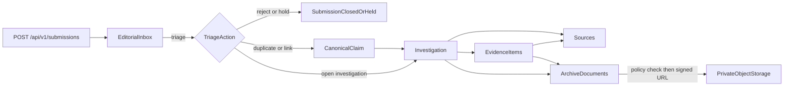

# Phase 2 — Editorial Intake, Research, and Access Safety (Detailed)

Parent plan: [.cursor/plans/five-phase-tvn-plan_ec4890e6.plan.md](.cursor/plans/five-phase-tvn-plan_ec4890e6.plan.md). Source requirements: FR-3, FR-4, FR-5, FR-9 and section 11 of [docs/Tibetan_FactCheck_PRD_and_Design.md](docs/Tibetan_FactCheck_PRD_and_Design.md).

## Starting point (from Phase 1)
- Models already exist but have no APIs: `Submission`, `SubmissionContact`, `Claim` in [backend/app/models/intake.py](backend/app/models/intake.py); `Investigation`, `Source`, `EvidenceItem` in [backend/app/models/research.py](backend/app/models/research.py); `ArchiveDocument`, `AccessGrant` in [backend/app/models/archive.py](backend/app/models/archive.py).
- Authorization today is role-only: `require_roles`, `RequireStaff`, and `RequirePlatformAdmin` in [backend/app/core/permissions.py](backend/app/core/permissions.py). There are no object-level checks.
- Missing pieces: rate limiting, object storage (Compose has no MinIO), an investigation membership model, a link between archive documents and investigations, and triage metadata.
- [backend/tests/test_api_surface.py](backend/tests/test_api_surface.py) asserts that no editorial CRUD routes exist, so it must be updated sub-phase by sub-phase.

## Scope assumptions
- Phase 2 is backend/API only. The public Submit page and editorial screens are Phase 4 work. Phase 2 delivers the API contracts they will call, covered by tests.
- Platform administrators get no editorial data access from the admin role alone; they need an editorial role as well. Restricted documents always require an explicit `AccessGrant`.
- Inaccessible objects return `404`, not `403`, so IDs cannot be enumerated.
- Every URL is stored as a reference only. Nothing is fetched remotely in this phase.

---

## Sub-phase 2.1 — Access policy and schema extensions
**Goal:** A single, tested authorization layer and the schema that later sub-phases need.

**Permission policy** (new `backend/app/core/policy.py`, with route deps in `backend/app/api/deps/access.py`)
- Define an `Action` enum, for example `SUBMISSION_LIST`, `SUBMISSION_TRIAGE`, `SUBMISSION_CONTACT_VIEW`, `INVESTIGATION_CREATE`, `INVESTIGATION_VIEW`, `INVESTIGATION_EDIT`, `INVESTIGATION_ASSIGN`, `EVIDENCE_WRITE`, `ARCHIVE_UPLOAD`, `ARCHIVE_VIEW_METADATA`, `ARCHIVE_DOWNLOAD`, `ARCHIVE_RECLASSIFY`, `ARCHIVE_GRANT`.
- `can(user, action, obj | None) -> bool` decides access from roles, object membership, and grants.
- Query-scoping helpers such as `scope_investigations(stmt, user)` and `scope_archive_documents(stmt, user)` apply the access filter in SQL before pagination. Routes must never filter results in Python after fetching them.
- Loader dependencies like `load_investigation(action)` fetch the object, run `can`, and raise `404` on denial.

**Baseline permission matrix** (encoded as a parametrized test table):
- **Researcher:** can list and triage submissions without seeing contact data. Can create investigations. Can view and edit only investigations they are assigned to. Can upload files to and view `INTERNAL` documents of those investigations.
- **Editor:** has all researcher abilities on every investigation. Can assign staff and view contact data, with each contact view audited. Can reclassify documents. Can grant restricted access, but only if the editor holds a grant on that document.
- **Approver:** sees only investigations they are assigned to and has read-only access to them in Phase 2. Approval-queue access arrives in Phase 3.
- **Platform administrator, no editorial role:** has no access to submissions, investigations, or archive documents.
- **`RESTRICTED` documents:** metadata and download require an active `AccessGrant`, meaning not expired and not revoked. The person who uploads or restricts a document receives a grant automatically.

**Schema changes** (one Alembic revision after `f4fcda4b6a93`)
- New `investigation_assignments` table with `investigation_id`, `user_id`, `assignment_role` (`owner` or `contributor`), `assigned_by_id`, `assigned_at`, and `removed_at`. It has a partial unique index on active rows. The existing `Investigation.owner_id` stays and is kept in sync with the active `owner` row.
- `submissions` gains `assigned_to_id`, `triaged_by_id`, `triaged_at`, `triage_note`, `duplicate_of_id` (self-FK), `text_fingerprint` (a hash of the NFC-normalized text), and `submitter_key_hash` (an HMAC of the client IP, used only for abuse checks).
- `sources` gains `author`, `source_language`, `reliability_notes`, `normalized_url`, and `position`.
- `evidence_items` gains `archive_document_id`, `position`, `verified_at`, and `verified_by_id`. The verification fields prepare for the Phase 3 readiness checks.
- `archive_documents` gains `investigation_id`, `original_filename` (sanitized), `sha256`, `upload_status` (`pending`, `available`, or `rejected`), and `classified_by_id`.
- New `rate_limit_counters` table with `bucket_key`, `window_start`, and `count`. It is Postgres-backed so the deployment needs no Redis, which keeps hosting within budget.
- Enable the `pg_trgm` extension and add trigram indexes on `submissions.claim_text` and `claims.canonical_text` for duplicate suggestions.
- New `AuditEventType` constants in [backend/app/services/audit.py](backend/app/services/audit.py) for triage, merges, assignments, contact views, uploads, reclassification, grants, and restricted-access link issuance.

**Test infrastructure**
- `backend/tests/factories.py` gains `make_user(roles=...)`, `make_submission`, `make_claim`, `make_investigation(assigned=[...])`, and `make_document(visibility=...)`.
- A shared `as_user(role)` client fixture builds on `login()` and `csrf_headers()` from [backend/tests/auth_helpers.py](backend/tests/auth_helpers.py).

**Exit check:** The migration upgrades and downgrades cleanly. Unit tests cover the full `can()` matrix. Any route that skips a loader dependency fails a route-inventory test, which asserts that every `/api/v1/editorial` and `/api/v1/investigations` route declares a policy dependency.

---

## Sub-phase 2.2 — Public intake and editorial triage
**Goal:** Anyone can submit a claim safely, and staff can triage it without losing the original wording.

**Public submission:** `POST /api/v1/submissions` in a new `backend/app/api/routes/submissions.py`, with logic in `backend/app/services/intake.py`
- Strict schema with `extra="forbid"`:
  - `claim_text`: 10–5,000 characters
  - `context_text`: up to 5,000 characters
  - `source_url`: optional
  - `contact`: optional name, email, and phone
  - `privacy_consent`: required to be `true` whenever any contact data is supplied
  - `website`: a honeypot field that must be empty
- Normalize text to Unicode NFC so Tibetan input is consistent. Reject control characters other than newlines and tabs. Store the original text exactly as submitted.
- Safe URL parsing (`backend/app/core/urls.py`):
  - Allow only `http` and `https`, with a maximum length of 2,048.
  - Reject URLs that embed credentials, plus `javascript:` and `data:` schemes.
  - Normalize hosts with IDNA and strip fragments.
  - Never fetch or resolve the URL.
- Abuse controls:
  - A request-size limit middleware for the public route, about 32 KB.
  - Rate limits per IP-HMAC key and a global limit, configurable through `SUBMISSION_RATE_LIMIT_*` settings.
  - The response is always a generic `202` with a receipt, whether the submission was accepted, flagged by the honeypot, or detected as a duplicate.
- Contact data is written only to `SubmissionContact`. Log redaction is extended to cover contact fields.
- Captcha or Cloudflare Turnstile goes behind a disabled-by-default interface. Turning it on is a launch decision.

**Editorial inbox:** under `/api/v1/editorial/submissions`
- `GET` returns a keyset-paginated list sorted by `(created_at, id)`, filterable by status, assignee, and channel. Contact data is never included.
- `GET /{id}` returns the submission, linked claim, and duplicate suggestions. Suggestions come from an exact `text_fingerprint` match plus trigram similarity above a configured threshold.
- `GET /{id}/contact` is editor-only and records an audit event.
- `POST /{id}/triage` takes a discriminated-union body with one of these actions:
  - `reject`, with a reason
  - `hold`, with a reason
  - `mark_duplicate`, with `duplicate_of_id`
  - `link_to_claim`, with `claim_id`
  - `create_claim`, with `canonical_text`; the original submission text is preserved
  - `assign`, with `user_id`
  - `open_investigation`, which creates or links the claim, creates the investigation, and assigns the triager as owner
- Triage runs in one transaction with row locking (`SELECT ... FOR UPDATE`) so two concurrent triage actions cannot both apply. Every action appends an audit event.
- Status changes in this phase are limited to `INBOX`, `TRIAGED`, `REJECTED`, and `ON_HOLD`. The full state machine is Phase 3.

**Claims:** `GET /api/v1/editorial/claims` and `GET /{id}` list and show claims with their linked submissions.

**Tests:**
- Validation edge cases, including Tibetan text, oversized bodies, and malicious URLs.
- Rate-limit windows.
- Honeypot behavior.
- Public responses never echo stored data.
- Contact data never appears in inbox or claim responses.
- Duplicate and merge linking.
- Concurrent triage.
- Unauthorized roles receive `404` or `403` as the policy requires.

---

## Sub-phase 2.3 — Investigation workspace and evidence provenance
**Goal:** Assigned staff can build a traceable evidence record. Nobody else can see it.

**Routes:** `backend/app/api/routes/investigations.py`, with logic in `backend/app/services/investigations.py` and `backend/app/services/evidence.py`
- `POST /api/v1/investigations` creates an investigation from a `claim_id` or a `submission_id`.
- `GET /api/v1/investigations` returns a scoped, keyset-paginated list with filters for `mine`, status, and owner.
- `GET` and `PATCH /{id}` read and update the workspace. `internal_notes` and the hold or reject reasons are returned only in the staff schema, never in a public one.
- `POST /{id}/assignments` and `DELETE /{id}/assignments/{user_id}` manage assignments. They are editor-only, cannot remove the last owner, are audited, and accept only active staff with editorial roles.
- `POST`, `PATCH`, and `DELETE` on `/{id}/sources` manage sources. Each source records its title, URL (validated by the same parser as 2.2), publisher, author, publication date, retrieval time (required; defaults to now), language, reliability notes, and position.
- `POST`, `PATCH`, and `DELETE` on `/{id}/evidence` manage evidence. Each item records its excerpt, notes, stance (`supports`, `contradicts`, or `contextualizes`), an optional `source_id`, an optional `archive_document_id`, and a position. Both referenced IDs must belong to the same investigation; otherwise the request fails with `422`, which prevents cross-investigation linking.
- `POST /{id}/sources/reorder` and `POST /{id}/evidence/reorder` reorder items.
- `POST /{id}/status` is limited to `RESEARCHING` and `ON_HOLD` (with a reason) in this phase.

**Provenance:**
- Every source and evidence item records `created_by_id` and `updated_by_id` through the existing `UserAuditMixin`.
- Deletes are hard deletes for now but write an audit event containing the removed item's summary. Phase 3 snapshots provide immutability after publication.

**Tests:**
- Researcher A cannot read, edit, or reference investigation B's sources, evidence, or documents.
- Requests with guessed UUIDs return `404`.
- Pagination-before-filtering: seed many inaccessible rows ahead of accessible ones and check that pages are full and counts are correct.
- Assignment removal immediately revokes access.
- An approver assigned to an investigation has read-only access.

---

## Sub-phase 2.4 — Private archive storage and the Phase 2 security gate
**Goal:** Files are stored privately, every download is authorized, and the Phase 2 exit gate is proven by tests.

**Storage abstraction:** `backend/app/storage/`
- An `ObjectStorage` protocol with `put_stream`, `delete`, `presign_get(key, ttl, filename)`, and `head`.
- `S3CompatibleStorage` (using `boto3`) works with any S3-compatible provider. `InMemoryStorage` is used in tests.
- Add a `minio` service plus a bucket-init job to [compose.yaml](compose.yaml).
- New settings in [backend/app/core/config.py](backend/app/core/config.py) and [.env.example](.env.example): `STORAGE_ENDPOINT_URL`, `STORAGE_BUCKET`, `STORAGE_ACCESS_KEY_ID`, `STORAGE_SECRET_ACCESS_KEY`, `STORAGE_REGION`, `ARCHIVE_MAX_UPLOAD_BYTES` (default 25 MB), and `ARCHIVE_SIGNED_URL_TTL_SECONDS` (default 120).
- Production guards require HTTPS endpoints and a non-default bucket.

**Archive API:** `backend/app/api/routes/archive.py`
- `POST /api/v1/investigations/{id}/documents` uploads a file:
  - The API proxies a multipart stream and aborts once the size limit is exceeded.
  - It checks the file's magic bytes against an allowlist: PDF, PNG, JPEG, WebP, plain text, and DOCX. The client-supplied MIME type is ignored.
  - It computes a SHA-256 hash and stores the file under a random key (`archive/{uuid}`) instead of the filename.
  - Visibility is always `INTERNAL`, whatever the request says.
  - The status moves from `pending` to `available`.
- `GET /api/v1/archive/documents` and `GET /{id}` return scoped metadata only, with no storage keys.
- `POST /{id}/classification` changes visibility. It is editor-only, requires a reason, and is audited. Moving a document to `RESTRICTED` grants the actor access automatically. No `PUBLIC_*` value makes anything public in Phase 2; the public archive is a Phase 4 decision.
- `POST /{id}/grants` and `DELETE /{id}/grants/{user_id}` manage `AccessGrant` rows, including optional expiry. Grants are audited.
- `POST /{id}/access-link` re-checks the policy on every call, then returns a presigned GET URL with a short TTL and `Content-Disposition: attachment`. Restricted documents always produce an audit event that includes the actor and request ID but not the URL.
- Antivirus scanning is recorded as a blocking launch decision rather than implemented here.

**Phase 2 security gate:** the suite in `backend/tests/security/`
- A full role-by-action-by-visibility matrix covering every Phase 2 route.
- Anonymous requests to every editorial route are rejected.
- Public routes never return editorial records, contact data, or storage keys. This is checked against the JSON schemas.
- Platform administrators are denied restricted documents.
- Expired and revoked grants are denied.
- Requests for another investigation's documents return `404`.
- Signed URLs expire, verified with a mocked clock on the in-memory storage.
- Uploads with a forged MIME type or an oversized body are rejected.
- Route-inventory and API-surface tests are updated in [backend/tests/test_api_surface.py](backend/tests/test_api_surface.py).
- CI gains a MinIO service and an S3 smoke test in [.github/workflows/ci.yml](.github/workflows/ci.yml).

**Documentation:**
- Update the local setup docs for MinIO.
- Add a short permission-matrix reference in `docs/access-policy.md`.
- Record open policy items in the launch-decision tracker: contact-data retention period, Turnstile enablement, antivirus scanning, and who may grant restricted access.

**Phase 2 exit gate (unchanged from the parent plan):** A submission can become an assigned investigation with traceable sources and evidence. Unauthorized users and public endpoints cannot discover editorial records, personal data, or private files. CI passes, including the security suite and the MinIO smoke test.

## Sequencing
- Sub-phases 2.1, 2.2, 2.3, and 2.4 run strictly in order. Each one ends with green CI and a checkpoint tag (`phase-2.1`, and so on).
- Within 2.2 and later, write the policy-matrix test rows before the route implementations.
