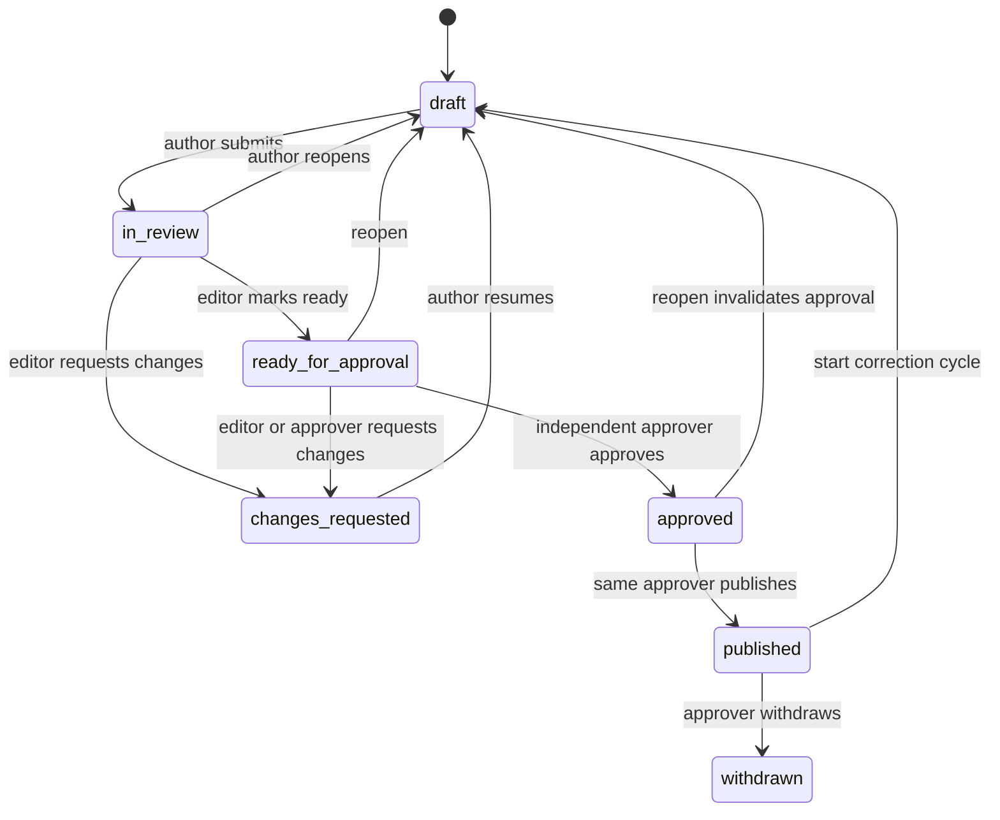

# Phase 3 — Review, Approval, Publication Integrity, and Corrections (Detailed)

Parent plan: [.cursor/plans/five-phase-tvn-plan_ec4890e6.plan.md](.cursor/plans/five-phase-tvn-plan_ec4890e6.plan.md). Source requirements: section 6.4, section 7, FR-7, FR-8, FR-10, and acceptance criteria 4–7, 12, and 13 of [docs/Tibetan_FactCheck_PRD_and_Design.md](docs/Tibetan_FactCheck_PRD_and_Design.md). Previous phase: [.cursor/plans/phase_2_detailed_plan_65148066.plan.md](.cursor/plans/phase_2_detailed_plan_65148066.plan.md).

## Starting point (from Phases 1 and 2)
- Models exist with no APIs in [backend/app/models/publication.py](backend/app/models/publication.py):
  - `FactCheck` has `workflow_status`, `public_slug`, and `published_at`.
  - `FactCheckContent` is per language, with `editorial_status`, `translation_status`, the public fields, and `verdict`.
  - `Review` has `decision`, which is `COMMENT`, `REQUEST_CHANGES`, or `APPROVE`.
  - `ArticleVersion` has `version_number`, a JSONB `snapshot`, and `content_checksum`.
- `WorkflowStatus` and `LanguageEditorialStatus` are defined in [backend/app/db/enums.py](backend/app/db/enums.py). Status changes are ad hoc today:
  - `change_investigation_status` in [backend/app/services/investigations.py](backend/app/services/investigations.py) allows only `RESEARCHING` and `ON_HOLD`.
  - Triage in [backend/app/services/intake.py](backend/app/services/intake.py) sets statuses directly.
- [backend/app/core/policy.py](backend/app/core/policy.py) has `Action`, `can()`, and the `scope_*` helpers. Approvers currently see only investigations they are assigned to.
- `EvidenceItem.verified_at` and `verified_by_id` exist and are not used yet.
- Audit is a plain insert through `record_audit_event` in [backend/app/services/audit.py](backend/app/services/audit.py). Nothing prevents `UPDATE` or `DELETE` on audit rows or article versions at the database level.

## Confirmed decisions for this phase
- **Three distinct people per language version, per publication cycle:**
  - The **author** is anyone who saved a revision of that language's public copy in the current cycle.
  - The **ready-marking editor** must hold the editor role and must not be an author.
  - The **approver** must hold the approver role, must not be an author, and must not be the ready-marking editor.
- **Only the approver who recorded the approval may publish.** If that approver cannot publish, the version must be reopened and approved again.
- Each language version is approved and published independently. Publishing one language never publishes the other.
- Editorial routes live under `/api/v1/editorial/factchecks/...`. The public `/api/v1/factchecks` namespace is reserved for Phase 4 and stays read-only for published snapshots.
- Public reads in Phase 4 come only from `ArticleVersion` snapshots, never from the live draft rows.
- Inaccessible objects still return `404`, and the backend remains the only enforcer.

---

## Sub-phase 3.1 — Workflow state machine, schema, and policy
**Goal:** All status changes go through one tested transition engine. The schema can enforce immutability at the database level.

**Transition engine** (new `backend/app/workflow/`)
- `transitions.py` defines explicit allow-lists for three subjects:
  - **Submission:** `INBOX` can go to `TRIAGED`, `REJECTED`, or `ON_HOLD`. `ON_HOLD` can go to `INBOX`, `TRIAGED`, or `REJECTED`. `TRIAGED` can go to `ON_HOLD` or `REJECTED`.
  - **Investigation:** `RESEARCHING` and `DRAFTING` can move between each other. Either can go to `ON_HOLD` or `REJECTED`. `ON_HOLD` returns to its previous status, which is stored in `hold_from_status`.
  - **Language content:** the diagram above, using `LanguageEditorialStatus`.
- `apply_transition(session, subject, to, actor, reason=None, guard_ctx=...)` follows the same steps every time:
  1. Lock the row with `SELECT ... FOR UPDATE`.
  2. Check the allow-list. Reject invalid moves with `409` and the error code `invalid_transition`.
  3. Run the guard functions: role, independence, and readiness.
  4. Set the status and any reason fields.
  5. Recompute the rollup.
  6. Append the audit event.
- **Rollup:** `FactCheck.workflow_status` and `Investigation.workflow_status` are derived inside the same transaction once drafting starts. Explicit `ON_HOLD` and `REJECTED` override the derived value and block content transitions. The derived value is chosen by the first rule that matches:
  - `PUBLISHED` if any language has a live version.
  - Otherwise `APPROVED` if any language is approved.
  - Otherwise `IN_REVIEW` if any language is in review or ready for approval.
  - Otherwise `CHANGES_REQUESTED` if any language has changes requested.
  - Otherwise `DRAFTING`.
- Refactor triage and `change_investigation_status` to call `apply_transition`. Nothing else may assign `workflow_status` or `editorial_status`. A lint-style test enforces this by grepping the services for direct assignment.

**Schema** (one Alembic revision after `a1b2c3d4e5f6`)
- **Enum additions.** Each `ALTER TYPE ... ADD VALUE` goes in its own autocommit block:
  - `LanguageEditorialStatus` gains `ready_for_approval` and `withdrawn`.
  - `ReviewDecision` gains `mark_ready`.
  - A new `ArticleVersionKind` enum has `initial`, `correction`, `update`, `clarification`, and `withdrawal`.
- **`fact_check_contents`** gains:
  - `limitations_markdown`
  - `current_revision_number`
  - `cycle_started_at`, which marks the start of the current publication cycle
  - `live_version_id`, a foreign key to `article_versions`
  - `withdrawn_at`
- **`investigations`** gains `hold_from_status`.
- **New `fact_check_content_revisions` table:** `id`, `content_id`, `revision_number`, `fields` (JSONB of the public draft fields plus source references), `checksum`, `created_by_id`, and `created_at`, with a unique constraint on `(content_id, revision_number)`. The table is append-only, and the set of authors is derived from it.
- **New `fact_check_content_sources` table:** `content_id`, `source_id`, `relevance_note` (public copy), and `position`. A source must belong to the fact check's investigation.
- **`reviews`** gains:
  - `revision_id`, the revision being reviewed
  - `invalidated_at` and `invalidated_reason`
  - a partial unique index allowing one active `approve` per `revision_id`
- **`article_versions`** gains:
  - `kind`
  - `correction_note`
  - `approval_review_id`, which is NOT NULL and references the approval
  - `revision_id`
  - `language`
  - `fact_check_id`

  `content_checksum` becomes NOT NULL.
- **Database immutability triggers:**
  - Reject every `UPDATE` and `DELETE` on `article_versions`, `fact_check_content_revisions`, and `audit_events`.
  - On `reviews`, allow only a single update that sets `invalidated_at` and `invalidated_reason` when they are NULL.
  - Reject `DELETE` on `reviews`.
- **Check constraint:** `editorial_status = 'published'` implies `live_version_id IS NOT NULL`.

**Policy extensions** in [backend/app/core/policy.py](backend/app/core/policy.py)
- New actions:
  - `FACTCHECK_CREATE`, `FACTCHECK_VIEW`, `DRAFT_EDIT`, and `DRAFT_SUBMIT`
  - `REVIEW_COMMENT`, `REVIEW_REQUEST_CHANGES`, and `REVIEW_MARK_READY`
  - `APPROVE`, `PUBLISH`, `CORRECTION_START`, `WITHDRAW`, and `AUDIT_VIEW`
- `scope_factchecks(stmt, user)` scopes through `scope_investigations`. Approvers additionally see fact checks with any language in `ready_for_approval` or `approved`, which is the approval queue. They get read-only access to the linked investigation's sources and evidence, but `RESTRICTED` documents still require a grant.
- Independence checks live in `backend/app/workflow/guards.py` as pure functions, such as `authors_of(content)`, `assert_not_author`, and `assert_is_approving_reviewer`. They are reused by the routes and the tests.

**Exit check:**
- The migration upgrades and downgrades cleanly.
- Every `(from, to)` pair for each subject is tested and matches the allow-list exactly.
- The triggers reject `UPDATE` and `DELETE` when raw SQL is issued directly.
- The route inventory test covers the new prefixes.

---

## Sub-phase 3.2 — Bilingual structured drafts and sanitized Markdown
**Goal:** Assigned staff write each language version independently. Public copy and internal notes stay separate, and Markdown is always safe to render.

**Routes:** new `backend/app/api/routes/factchecks.py`, with logic in `backend/app/services/drafts.py`
- `POST /api/v1/investigations/{id}/factcheck` creates the `FactCheck` and one `FactCheckContent` per requested language. The investigation moves to `DRAFTING`. Only one fact check is allowed per investigation, which the schema already enforces.
- `GET /api/v1/editorial/factchecks` returns a scoped, keyset-paginated list. It filters by status, language, `mine`, and `awaiting_my_approval`.
- `GET /api/v1/editorial/factchecks/{id}` returns both language summaries, readiness, and the live version numbers.
- `PATCH /api/v1/editorial/factchecks/{id}` sets the slug. The slug is validated, unique, and immutable once any language has been published.
- `GET` and `PATCH /api/v1/editorial/factchecks/{id}/languages/{lang}` read and edit a language draft:
  - Editable fields: title, summary, claim, context, verdict proposal, verdict explanation, analysis Markdown, limitations Markdown, and translation status.
  - The body must include `expected_revision`. A stale value returns `409`, which is optimistic locking.
  - Edits are allowed only in `draft` or `changes_requested`. Any other state returns `409` and tells the client to reopen first.
  - Each save that changes public fields appends a revision row with its checksum. Translation status and investigation internal notes are not material and create no revision.
- `PUT .../languages/{lang}/sources` replaces the ordered source references with relevance notes. Sources from another investigation return `422`.
- `POST .../languages/{lang}/preview` returns sanitized HTML for the editor preview and stores nothing.
- `GET .../languages/{lang}/revisions` lists revision metadata and authors.

**Markdown safety:** new `backend/app/core/markdown.py`
- Parse with `markdown-it-py` with raw HTML disabled, then sanitize with an `nh3` allowlist:
  - Allowed: headings, paragraphs, emphasis, lists, blockquotes, code, tables, and links.
  - Links must be `http` or `https` and get `rel="nofollow noopener noreferrer"`.
  - Images are not allowed at launch.
- Run the input text validation from [backend/app/core/text_validation.py](backend/app/core/text_validation.py), including NFC normalization and the control-character check, on every text field.
- Add the dependencies to [backend/pyproject.toml](backend/pyproject.toml) and update `uv.lock`.

**Public versus internal separation**
- `DraftResponse` (staff) and the future `PublicArticleSnapshot` are separate Pydantic models, both with `extra="forbid"`.
- Investigation internal notes, review comments, and author IDs never enter draft public fields or snapshots.

**Tests:**
- Tibetan and English round trips.
- An XSS corpus (script, `javascript:` links, event attributes, raw HTML, and data URIs) is stripped.
- A stale `expected_revision` returns `409`.
- Edits in locked states return `409`.
- Cross-investigation source references return `422`.
- Revision authorship is tracked.
- An unassigned researcher receives `404`.

---

## Sub-phase 3.3 — Review, readiness checks, and independent approval
**Goal:** A language version can be approved only after editor review, by a separate approver, against the exact revision that was reviewed.

**Readiness checks:** `backend/app/workflow/readiness.py`, with rules in `backend/app/core/editorial_rules.py`
- `check_readiness(content) -> list[ReadinessIssue]` returns stable issue codes. The rules are:
  - These fields are present: title, claim, context, verdict, verdict explanation, analysis, and limitations.
  - At least `MIN_PUBLIC_SOURCES` source references are linked (default 1).
  - Every evidence item linked to a referenced source has `verified_at` set. This is the PRD rule that quotations must be checked against the original.
  - The investigation is not `ON_HOLD` or `REJECTED`.
  - The slug is set.
  - `translation_status` is consistent with the other language's state.
  - The sanitized Markdown is non-empty.
- `GET .../languages/{lang}/readiness` returns the issue list.
- The checks are enforced at submit-for-review (warnings only), at mark-ready, at approve, and at publish (all blocking).
- Add `POST /api/v1/investigations/{id}/evidence/{eid}/verify`, which sets `verified_at` and `verified_by_id` and is audited. Editing the excerpt or source of verified evidence clears the verification.

**Review actions** (each runs through `apply_transition` where it changes state, and each writes a `Review` row bound to the current `revision_id`)
- `POST .../submit-for-review` moves `draft` to `in_review`. Authors or assigned writers may do this.
- `POST .../reviews` records a comment. It accepts an optional field anchor and does not change state.
- `POST .../request-changes` requires a reason. An editor who is not an author can use it from `in_review`. An editor or approver can use it from `ready_for_approval`.
- `POST .../mark-ready` moves `in_review` to `ready_for_approval`. It requires an editor who is not an author and who passes readiness.
- `POST .../approve` moves `ready_for_approval` to `approved`. It requires:
  - The approver role.
  - Not an author.
  - Not the ready-marking editor.
  - Readiness passes.
  - `expected_revision` equals `current_revision_number`.

  The approval row is bound to the revision.
- `POST .../reopen` moves `in_review`, `ready_for_approval`, or `approved` back to `draft`. It requires a reason and invalidates every active `mark_ready` and `approve` review for the cycle. This is the only way to edit after approval, so re-approval after a material change is structural.
- `GET /api/v1/editorial/approval-queue` returns a scoped list of `ready_for_approval` items that the caller may approve, which excludes the caller's own work.

**Audit events:** new `AuditEventType` constants for every review action, readiness override attempts, approval invalidation, and evidence verification.

**Tests:**
- A role-combination matrix, including one person holding researcher, editor, and approver together. That person can never fill two roles on the same cycle.
- Self-approval is denied.
- A ready-marking editor trying to approve is denied.
- After an approval, editing returns `409`, reopening invalidates the approval, and re-approval is required.
- An approval request with a stale revision is rejected.
- Two concurrent approvals produce exactly one approval. Run this with two sessions against real Postgres.
- An approver outside the queue scope receives `404`.

---

## Sub-phase 3.4 — Transactional publication, immutable snapshots, corrections, and the Phase 3 gate
**Goal:** Publication is atomic and leaves an immutable record. Corrections never overwrite history.

**Publication:** `backend/app/services/publication.py`, at `POST .../languages/{lang}/publish`
- One transaction performs these steps:
  1. Lock the content row and the fact check.
  2. Require `approved` status.
  3. Require the caller to be the approver on the active approval.
  4. Require the approval's `revision_id` to equal the current revision, with checksums equal.
  5. Re-run readiness.
  6. Build the `PublicArticleSnapshot`, an allow-listed Pydantic model. It contains `schema_version`, the public fields, the analysis Markdown and the sanitized HTML, limitations, the public source list (title, publisher, URL, date, relevance note), verdict, translation link status, the attribution per policy, `kind`, `correction_note`, and `published_at`.
  7. Compute the SHA-256 of the canonical JSON (sorted keys, compact separators).
  8. Insert an `ArticleVersion` with the next `version_number`.
  9. Set `live_version_id`, `published_at`, and the status, recompute the rollup, and record a `factcheck.published` audit event.
- Any exception rolls back everything. A unique constraint on `(content_id, version_number)` plus the row lock means concurrent publish requests produce exactly one version.
- The first publication of a language sets `FactCheck.published_at` and freezes the slug.

**Corrections and withdrawal**
- `POST .../corrections` takes `kind` (`correction`, `update`, or `clarification`) and a reason. It moves `published` to `draft` and opens a new cycle by setting `cycle_started_at`, so the author set resets. The live version remains public during this.
- Publishing a correction cycle requires a non-empty public `correction_note` and goes through the same review, mark-ready, and approval flow. It creates version n+1 with that `kind`. Earlier versions stay readable through the version endpoints.
- `POST .../withdraw` is limited to approvers and requires a public notice and an internal reason. It creates a `withdrawal` version (a tombstone snapshot carrying the notice), sets the status to `withdrawn`, and is audited. Whether withdrawn articles show a notice or return `410` publicly is a Phase 4 rendering decision, and the data model supports both.
- `GET .../versions` and `GET .../versions/{n}` let staff view the full immutable history, with each version's checksum re-verified on read.

**Audit access**
- `GET /api/v1/editorial/audit?subject_type=&subject_id=` gives editors and approvers the scoped history of objects they can view.
- Payloads are sanitized and never include contact data or signed URLs.

**Launch policies:** new `docs/editorial-policy.md`, with the enforceable rules in `backend/app/core/editorial_rules.py`
- Cover verdict criteria and examples (the content comes from the editorial team), source standards, required publication fields, corrections, updates, clarifications, withdrawals and takedowns, attribution (named staff or a team byline), and approver assignment.
- Every rule that code enforces links to its test. Unresolved items go into [docs/launch-decisions.md](docs/launch-decisions.md):
  - Minimum staffing of three people per language cycle.
  - Attribution style.
  - Final verdict definitions.
  - Public rendering of withdrawn articles.
  - Whether an approver-unavailable fallback is needed.

**Phase 3 security gate:** `backend/tests/security/test_phase3_gate.py`, plus updates to [backend/tests/test_api_surface.py](backend/tests/test_api_surface.py) and `test_route_policy_inventory.py`
- A test for every allowed and forbidden transition, for each subject.
- Role and independence combinations: author, ready-marking editor, approver, a non-approving approver, and the platform administrator.
- After approval, editing is blocked, and a checksum mismatch at publish is rejected.
- Concurrency with two sessions against Postgres: double approval, double publish, and publishing while a reopen is in flight.
- Snapshot immutability: ORM updates fail, raw SQL `UPDATE` and `DELETE` fail through the triggers, and checksums verify.
- Rollback on partial failure: inject a failure into the audit write and the snapshot insert, then assert there is no version, the status is unchanged, and no audit row was written.
- Snapshot JSON contains only allow-listed keys. It never contains internal notes, review comments, contact data, storage keys, or user emails.
- Publishing one language leaves the other language unpublished, with its translation status shown as pending.
- A correction creates n+1, and version n is unchanged and still retrievable.
- CI runs this suite against the Postgres service in [.github/workflows/ci.yml](.github/workflows/ci.yml).

**Phase 3 exit gate (unchanged from the parent plan):** A different authorized person must approve each language version. Publication always creates an immutable snapshot and an audit trail. Corrections preserve history. Bypass and race-condition tests pass. CI is green.

## Sequencing
- Sub-phases 3.1, 3.2, 3.3, and 3.4 run strictly in order. Each one ends with green CI and a checkpoint tag (`phase-3.1`, and so on).
- In each sub-phase, write the transition-table and policy-matrix test rows before implementing the routes.
- Draft `docs/editorial-policy.md` in parallel with the editorial team from 3.1 onward. The verdict definitions must be final before the Phase 3 gate.
