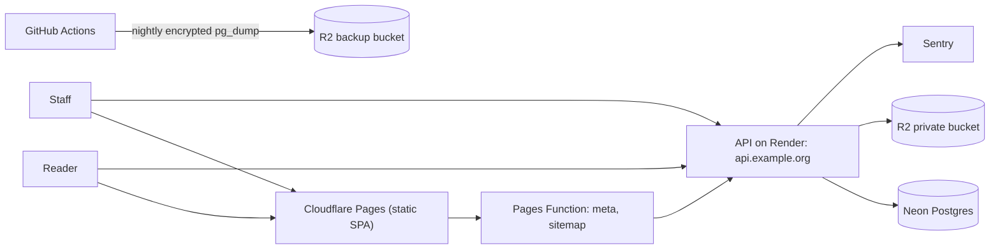

# Phase 4 — Public Bilingual Experience and Managed Deployment (Detailed)

Parent plan: [.cursor/plans/five-phase-tvn-plan_ec4890e6.plan.md](.cursor/plans/five-phase-tvn-plan_ec4890e6.plan.md). Source requirements: sections 6.1, 6.2, 8 (FR-1, FR-2, FR-3, FR-8), 9, 11, 12, and acceptance criteria 1, 2, 9, 10, 11 of [docs/Tibetan_FactCheck_PRD_and_Design.md](docs/Tibetan_FactCheck_PRD_and_Design.md). Previous phase: [.cursor/plans/phase_3_detailed_plan_2e6c510a.plan.md](.cursor/plans/phase_3_detailed_plan_2e6c510a.plan.md).

## Starting point (from Phases 1–3)
- Backend has the complete editorial workflow under `/api/v1/editorial/factchecks/...`, immutable `ArticleVersion` snapshots built by `_build_public_snapshot` in [backend/app/services/publication.py](backend/app/services/publication.py), and `PublicArticleSnapshot` (`schema_version = 1`) in [backend/app/schemas/factchecks.py](backend/app/schemas/factchecks.py).
- There are **no public read routes**. [backend/tests/test_api_surface.py](backend/tests/test_api_surface.py) allows only `POST /api/v1/submissions` as public API surface.
- **No topic/tag model** exists. `pg_trgm` is enabled (migration `a1b2c3d4e5f6`) but only used for duplicate intake.
- Frontend: React 19, Vite, react-router v7, custom i18n (`en`/`bo`, no URL prefix, stored in `localStorage`), plain `fetch` client with CSRF, Vitest + axe. Real pages are only Home, Login, Activate, EditorialHome. `/fact-checks`, `/submit`, `/about`, and all `/editorial/*` sections are `PlaceholderPage` ([frontend/src/routes.tsx](frontend/src/routes.tsx)).
- No Playwright, no deployment manifests, no error monitoring, no backup tooling. Frontend Dockerfile runs the Vite dev server only.

## Confirmed decisions for this phase
- **Hosting:** Cloudflare Pages (static frontend + Pages Functions), Render or Fly.io for the API (final pick after a pricing check in 4.4, Render is the default), Neon Postgres, Cloudflare R2 private storage. Use one registrable domain: site at `example.org`, API at `api.example.org`, so the `SameSite=Lax` session cookie stays first-party.
- **Topics:** staff-managed list with Tibetan and English names. Editors assign topics per fact check. Topic slugs are captured in the published snapshot, so topic changes on a published article take effect with the next published version.
- **Withdrawn articles:** URL stays live (HTTP 200) with the withdrawal notice and date; withdrawn articles are excluded from lists, search, topics, and sitemap.
- **URLs and metadata:** public routes are locale-prefixed (`/bo/...`, `/en/...`). A Cloudflare Pages Function injects per-language `<title>`, description, canonical, `hreflang`, and Open Graph tags into article and static pages. `/editorial/*` stays unprefixed.
- **Public archive (`PUBLIC_METADATA` / `PUBLIC_DOCUMENT`) stays out of Phase 4**; no public archive routes. Record this as deferred to post-launch (PRD P1 "archive metadata search") in [docs/launch-decisions.md](docs/launch-decisions.md).
- Public reads come only from live `ArticleVersion` snapshots and a derived public index, never from draft rows. Unpublished or unknown slugs return `404`.

---

## Sub-phase 4.1 — Public read API, topics, and bilingual search
**Goal:** Allow-listed, cache-friendly public endpoints that can only ever expose published snapshot data, with search that works for Tibetan and English.

**Topics** (one Alembic revision after `c9d0e1f2a3b4`)
- New `topics` table: `id`, `slug` (unique, immutable once used in a published version), `name_bo`, `name_en`, `description_bo`, `description_en`, `position`, `is_active`. Topics are deactivated, never deleted.
- New `fact_check_topics` (`fact_check_id`, `topic_id`), editable by editors on any fact check they can view; changes are audited.
- New policy actions `TOPIC_MANAGE` (editors and admins) and `FACTCHECK_TOPICS_EDIT` in [backend/app/core/policy.py](backend/app/core/policy.py).
- Editorial routes: `GET/POST/PATCH /api/v1/editorial/topics`, `PUT /api/v1/editorial/factchecks/{id}/topics`.
- Bump `PublicArticleSnapshot.schema_version` to `2` and add `topics: list[str]` (slugs). Readers must accept both versions; v1 snapshots read as `topics = []`.

**Public index projection**
- New `public_articles` table, one row per published language: `content_id` (PK), `fact_check_id`, `language`, `slug`, `live_version_id`, `version_number`, `title`, `summary`, `verdict`, `topics text[]`, `first_published_at`, `last_published_at`, `is_withdrawn`, `search_text`, `search_tokens text[]`.
- Written **only** by the publication service inside the existing publish, correction-publish, and withdraw transactions. Extend the direct-assignment lint test to enforce this.
- Add a `tvn-rebuild-public-index` command that rebuilds rows from live snapshots, plus a test that the projection matches snapshots exactly.

**Search** (new `backend/app/services/public_search.py`, rules in `backend/app/core/search_text.py`)
- Normalization: NFC, lowercase Latin, strip Tibetan tsheg/shad and punctuation for `search_text`, and split Tibetan on tsheg into syllable tokens for `search_tokens`.
- Indexes: GIN `gin_trgm_ops` on `search_text`, GIN on `search_tokens`, and btree on `(language, is_withdrawn, last_published_at)`, `verdict`, plus GIN on `topics`.
- Query: Tibetan terms match by syllable-token containment, with trigram `ILIKE` substring fallback; English uses trigram `ILIKE` plus `similarity` ranking.
- **Spike first:** verify that `pg_trgm` extracts trigrams from Tibetan under Neon's collation (`show_trgm` on sample text). If it does not, Tibetan relies on syllable tokens only and this is documented.
- Seed script `backend/scripts/seed_search_corpus.py` generates about 5,000 bilingual published articles. Record `EXPLAIN ANALYZE` plans in a new `docs/search.md`.

**Public endpoints** (new `backend/app/api/routes/public_factchecks.py`, schemas in `backend/app/schemas/public.py`, all `extra="forbid"`)
- `GET /api/v1/factchecks?q=&lang=&verdict=&topic=&from=&to=&cursor=&limit=` returns keyset-paginated cards: slug, language, title, summary, verdict, topics, published and updated dates. Caps on `q` length and `limit`.
- `GET /api/v1/factchecks/{slug}?lang=` returns the live snapshot (checksum verified on read), translation links for the other language (`published`, `pending`, or `unavailable`), and a version history summary (number, kind, date, correction note). Withdrawn returns the notice payload.
- `GET /api/v1/factchecks/{slug}/versions/{n}?lang=` returns a prior public version.
- `GET /api/v1/topics` and `GET /api/v1/topics/{slug}` return active topics with published counts per language.
- Headers: `Cache-Control: public, max-age=60, stale-while-revalidate=300`, `ETag` from checksum, never `Set-Cookie`, CORS without credentials needed.

**Tests**
- Update `test_api_surface.py` and `test_route_policy_inventory.py` for the new public routes.
- Field-leak test: create content with canary strings in internal notes, review comments, contact data, storage keys, and emails; assert none appear in any public response.
- Draft, in-review, approved-not-published, and guessed slugs return `404`. Publishing one language does not expose the other.
- Correction updates the index row and history; withdrawal removes the article from list and search but the detail returns the notice.
- Tibetan and English search relevance cases, filter combinations, and pagination stability.

**Exit check:** public endpoints serve only snapshot-derived data, search works in both languages with documented query plans, CI is green.

---

## Sub-phase 4.2 — Public bilingual site
**Goal:** Readers can browse, search, read, and submit in Tibetan or English with correct per-language metadata.

**Routing and i18n** (update [frontend/src/routes.tsx](frontend/src/routes.tsx) and [frontend/src/i18n/](frontend/src/i18n/))
- Public routes under `/:locale(bo|en)`: home, `fact-checks` (search), `fact-checks/:slug`, `fact-checks/:slug/versions/:n`, `topics`, `topics/:slug`, `about` (mission, methodology, verdict definitions, corrections policy), `submit`.
- `/` and unprefixed legacy paths redirect using stored preference, then browser language, then `en`.
- The language switcher on an article goes to the translation when published; otherwise it shows the article page in the chosen UI language with a "translation pending/unavailable" notice and a link to the available version.
- Add `@tanstack/react-query` for data fetching and caching (used by the editorial UI too).

**Pages and components**
- Home: mission, prominent search, latest fact-checks, topic entry points, how-it-works, submit CTA, policy links.
- Search: query field, verdict/topic/language/date filters synced to the URL, result cards, accessible "load more", clear empty/error/loading states.
- Article, in the PRD order: title, verdict badge and explanation, claim, context and analysis, limitations, sources (publisher, title, URL, date, relevance), attribution, publication and updated dates, version/correction history, translation link. Withdrawn articles show the notice only.
- `VerdictBadge`: text label plus icon plus color, linked to the verdict definition.
- `SanitizedHtml`: the only place server HTML is rendered, with DOMPurify as defense in depth.
- Submit form for `POST /api/v1/submissions`: claim, where encountered, optional source URL, optional contact details, consent, privacy notice, "no guarantee of investigation" text, Turnstile widget behind configuration, field errors through the existing `ErrorSummary`/`TextField`, and a success state that reveals no internal IDs.

**Metadata** (new `frontend/functions/`)
- Pages Function for `/:locale/fact-checks/:slug` fetches the public API server-side and uses `HTMLRewriter` to set `lang`, title, description, canonical, `hreflang` alternates, and Open Graph tags. Static pages get per-locale meta from a small map.
- `sitemap.xml` (published, non-withdrawn, both locales) and `robots.txt` (disallow `/editorial`).
- `_headers` file: strict CSP (no inline scripts), HSTS, `X-Frame-Options: DENY`, `Referrer-Policy`, `Permissions-Policy`.

**Tests**
- Vitest + axe for every public page in both locales, including Tibetan text rendering in components.
- Unit tests for the Pages Function meta injection and sitemap.
- Add Playwright (`frontend/e2e/`, `@axe-core/playwright`) running against the Compose stack, with first flows: search, read, switch language, pending translation, withdrawn notice, submit.

**Exit check:** all public pages work in both locales with correct metadata, axe reports no violations, Playwright public flows pass locally and in CI.

---

## Sub-phase 4.3 — Editorial interface for the full non-AI workflow
**Goal:** Staff can complete submission-to-publication through the UI. The UI never acts as a security boundary.

**Shared building blocks**
- Role-aware editorial navigation and a dashboard showing "my next actions" (assigned work, reviews pending, approval queue).
- Accessible `ConfirmDialog` (focus trap, explicit consequence text, typed confirmation for publish and withdraw), live-region notifications, and a status/next-action header on every object.
- Consistent error handling: `404` shows "not found or no access", `409` shows a conflict with a reload option, `422` maps to field errors.
- Internal-only content (notes, review comments, contact data) is styled and labeled as "Internal — never published", structurally separate from public copy fields.

**Screens**
- Inbox: list and filters, submission detail with original wording, explicit audited "reveal contact" action, triage actions (reject, hold, duplicate, merge to canonical claim, assign, open investigation).
- Investigations: list, workspace with status, assignments, sources, evidence (support/contradict/context, reliability notes, verify action), internal notes, and archive documents (upload, classify, grants, request short-lived link).
- Fact-check: create from investigation, slug, topics, per-language draft editor with structured fields, Markdown textarea and server preview, `expected_revision` conflict UI, ordered source references with relevance notes, readiness panel, review thread, and actions for submit, comment, request changes, mark ready, reopen.
- Approval queue and approve flow showing the exact revision being approved; publish confirmation showing a preview of the public snapshot; corrections (kind and correction note); withdraw (approver only); version history viewer with checksum status.
- Audit history view, topic management, and admin users (invite, roles, disable).

**Backend gap-fill**
- Add only the small endpoints the UI needs and that do not exist yet, for example `GET /api/v1/admin/users` and a snapshot preview endpoint for the publish dialog. Each gets policy, inventory, and permission tests.

**Tests**
- Component tests with axe for every editorial screen.
- Tests proving controls hidden by role still get backend `404`/`403` when called directly.
- Playwright editorial flows for triage, evidence verification, drafting with a conflict, review, and approval.

**Exit check:** a team of three seeded staff can take a submission to a published, corrected, and withdrawn article in both languages using only the UI.

---

## Sub-phase 4.4 — End-to-end hardening, managed deployment, and the Phase 4 gate
**Goal:** Prove the product is safe and accessible, then run it in staging and production with tested backups.

**End-to-end and accessibility** (Playwright, Chromium plus mobile WebKit emulation, new CI job against the Compose stack)
- Submission to publication with distinct author, ready-marking editor, and approver.
- Independent language publishing, with the other language shown as pending.
- Public/private separation: crawl every public page and API response for the 4.1 canary strings.
- Guessed IDs and slugs for unpublished content; anonymous access to editorial routes.
- Keyboard-only runs of submit, search, article, triage, and approve; axe on every page in both locales.
- Manual device matrix for Tibetan rendering and input (iOS Safari, Android Chrome with a Tibetan keyboard, Windows Chrome/Edge, macOS Safari), recorded in a new `docs/accessibility-testing.md`.

**Deployment**
- New `docs/hosting.md`: confirm current pricing for Pages, Render vs Fly.io, Neon, R2, and Sentry against the US$10–30/month target, then fix the API host.
- Environments: `staging` and `production` with separate Neon projects/branches, R2 buckets, secrets, and domains.
- API: build from [backend/Dockerfile](backend/Dockerfile), run `alembic upgrade head` as a pre-deploy step, health check on `/ready`, keep the image ready for a separate worker process in Phase 5.
- Neon: pooled connection string for the app, direct connection for migrations; verify driver compatibility with the pooler.
- Backend hardening: exact-origin CORS, `Secure` cookies, trusted proxy handling so submission rate limits use the real client IP, `TrustedHostMiddleware`, `/docs` disabled in production, Turnstile enabled for submissions, Cloudflare rate-limiting rules on public API paths.
- CI/CD in [.github/workflows/](.github/workflows/): deploy staging on `main`, production on tag; Pages via `wrangler pages deploy`; post-deploy smoke tests.
- Monitoring: Sentry for backend and frontend with PII scrubbing (no cookies, contact data, or request bodies), uptime check on `/ready`, defined log retention.

**Backups and restore**
- Neon point-in-time restore as the first line, plus a nightly encrypted `pg_dump` to a separate R2 backup bucket with separate credentials (scheduled GitHub Action). Periodic copy of the archive bucket to the backup bucket.
- Restore drill in staging: restore into a fresh database, run migrations, re-verify every `ArticleVersion` checksum, rebuild and compare the public index, and confirm archive objects resolve. Record the time taken and the data-loss window.
- New `docs/runbook.md`: deploy, rollback, migration failure, restore, secret rotation, incident response, takedown/withdrawal procedure.

**Docs and decisions**
- Update [docs/launch-decisions.md](docs/launch-decisions.md): withdrawn rendering decided (notice page), topics model, hosting selection, public archive deferred, Turnstile status.
- Update [README.md](README.md) and [docs/local-development.md](docs/local-development.md) for locale routes, Pages Functions, and Playwright.

**Phase 4 exit gate (from the parent plan):** users can submit, search, filter, and read only published content in Tibetan or English; staff can complete the non-AI workflow through the UI; security and accessibility checks pass in staging; backup restoration is proven. CI is green.

## Sequencing
- Sub-phases run in order, each ending with green CI and a checkpoint tag (`phase-4.1`, and so on).
- Run the Tibetan trigram spike at the very start of 4.1, since it decides the search design.
- Create Cloudflare, Neon, and Render accounts and the domain during 4.1 so staging exists before 4.4 device testing.
- Editorial copy for About/Methodology and verdict definitions must be supplied in both languages by the end of 4.2.
