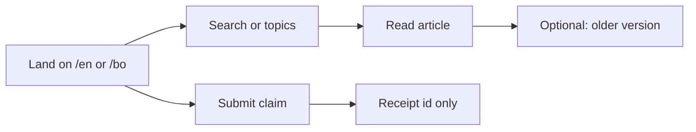
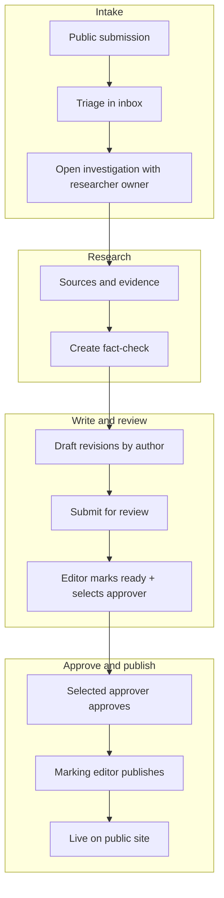
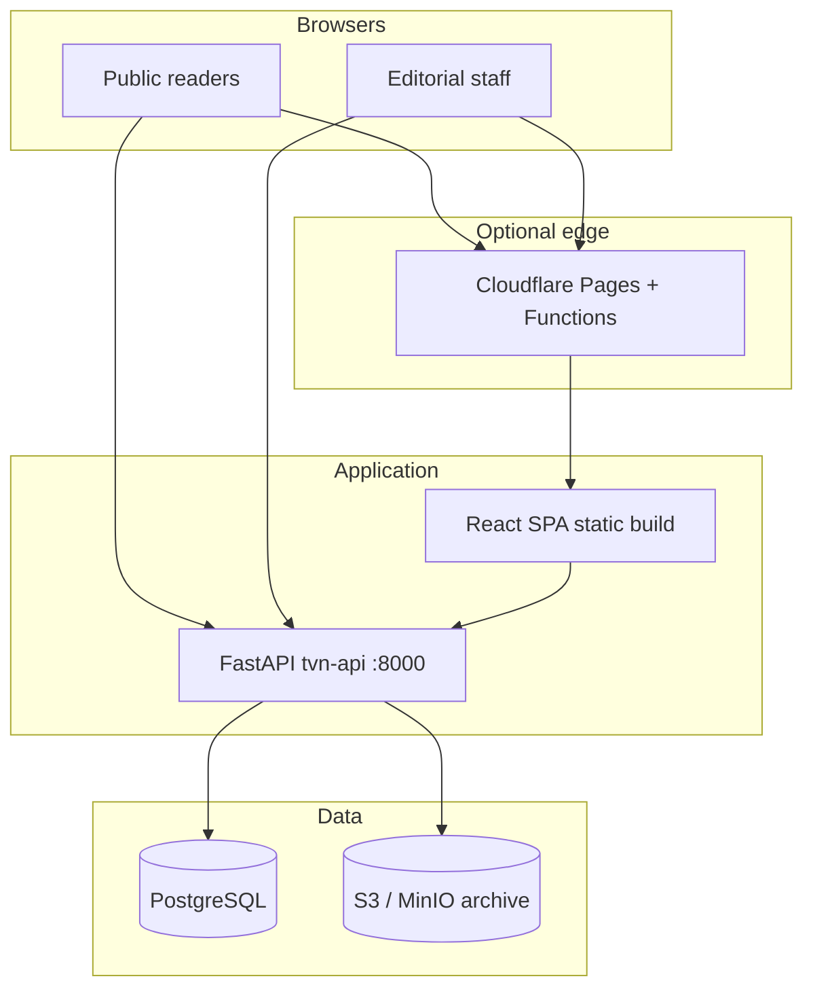
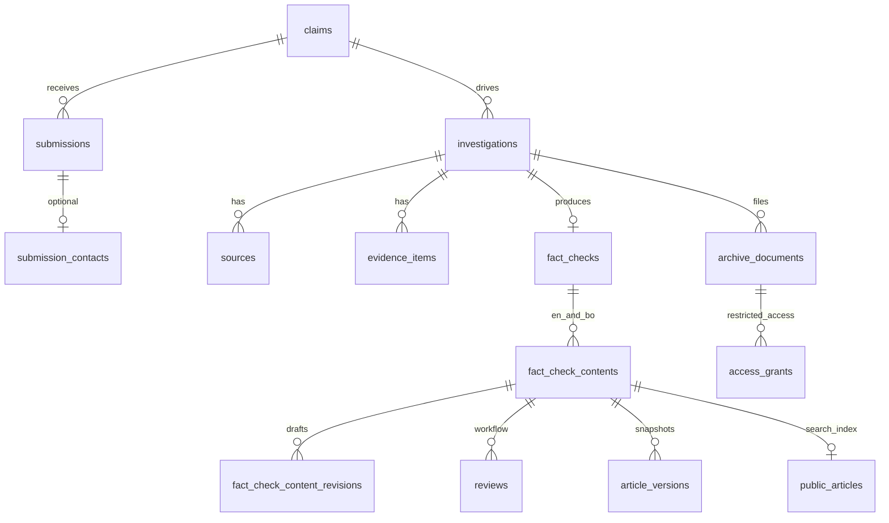

# Tibetan Verification Network — Application features (internal)

**Audience:** Editorial leads, product, engineering, and operations planning TVN’s next steps.  
**Scope:** What the **shipped codebase** does today (not aspirational Phase 5 AI).  
**Also useful:** [workflow-testing.md](workflow-testing.md) (step-by-step claim walkthrough), [launch-decisions.md](launch-decisions.md) (open policy choices).

**Last reviewed against codebase:** November 2026 · API version **0.1.0**

---

## 1. What this application is

The **Tibetan Verification Network (TVN)** is a bilingual fact-checking platform:

| Surface | Who | Login |
| --- | --- | --- |
| **Public website** | Readers, community members | No account |
| **Editorial workspace** | Researchers, editors, approvers | Invite-only staff accounts |
| **Platform admin** | IT / lead | Same login; extra admin screens |

Languages on the public site are **English** (`/en/...`) and **Tibetan** (`/bo/...`). Each published fact-check can have **independent language versions** (separate drafts, review, and publication).

Core promise in software:

- **Transparent public articles** with verdict, sources, version history, and corrections.
- **Private research** (investigations, internal files, submitter contact) kept off public APIs.
- **No single person can shortcut** from claim to publication: independence rules are enforced in the workflow engine.

There is **no** public registration, **no** reader comments, and **no** automated AI publishing in the current code.

---

## 2. User types and what they can do

### 2.1 Readers (public)

**Can:**

- Browse home, search fact-checks, filter by language and query.
- Open an article, read current content, open **past versions**, see withdrawal notices.
- Browse **topics** and see articles tagged to a topic.
- Read **About** and **Membership** information pages (content is i18n strings).
- **Submit a claim** anonymously: claim text, optional context and source URL, optional contact (with privacy consent).

**Cannot:**

- Sign in, comment, or access editorial or archive material.
- See whether a submission was accepted (they only get a **receipt id**).

**Abuse limits on submit:** body size cap, rate limits per IP and globally, optional Cloudflare Turnstile captcha in production when configured.

### 2.2 Submitters

Same as readers; “submitter” is anyone using the submit form. Contact details are stored separately and are **not** shown on the public submission response.

### 2.3 Staff roles

Staff receive **one or more roles** at invite time. The product is designed so **one person should not hold all editorial roles** on the same language version in normal operations.

| Role | Main responsibilities in the app |
| --- | --- |
| **Researcher** | Inbox (no contact details), triage, assigned investigations, draft writing, evidence work |
| **Editor** | Full inbox (contact view is **audited**), all investigations, review drafts, **mark ready** (must pick an approver), **publish** approved work, corrections, withdrawal (policy requires editor role), topic management, archive (internal + grants for restricted) |
| **Approver** | **Approval queue** only for items where they were **selected at mark-ready**; approve with independence checks; view audit on records they can see |
| **Platform administrator** | Invite users, assign roles, disable users — **does not** get editorial or archive access unless they also have editorial roles |

**Navigation is role-aware:** menus and buttons hide actions the user cannot perform. If someone hits a forbidden record directly, the API returns **404** (not “access denied”) so internal ids are not probeable.

### 2.4 Platform administrator

- UI: `/editorial/admin/users`
- Creates invites (token shown once; **email is not sent by the app** — ops must deliver the `/activate?token=...` link).
- Cannot triage, edit investigations, or read restricted archive without separate editorial roles.

---

## 3. Feature catalog (what exists today)

### 3.1 Public website features

| Feature | User value | Status |
| --- | --- | --- |
| Localized URLs (`/en`, `/bo`) | SEO and language choice | Shipped |
| Fact-check search & listing | Find articles | Shipped |
| Article detail + translation links | Cross-language navigation | Shipped |
| Version history | Accountability, corrections | Shipped |
| Withdrawn articles | Public notice; excluded from search/lists/sitemap | Shipped |
| Topics browse | Thematic grouping | Shipped |
| Claim submission form | Public intake | Shipped |
| Security headers / CSP | Browser hardening | Shipped (`_headers`, hosting config) |
| Server-side meta for crawlers | Optional SEO | Shipped via Cloudflare Pages Functions |

### 3.2 Editorial workspace features

| Area | Features | URL pattern (app) |
| --- | --- | --- |
| **Overview** | Role-based home | `/editorial` |
| **Inbox** | List submissions, triage (reject, hold, duplicate, link claim, open investigation), view detail | `/editorial/inbox` |
| **Submitter contact** | Editor-only, audited | Submission detail |
| **Investigations** | Status, assignments, sources (ordered), evidence (verify step), link to fact-check creation | `/editorial/investigations` |
| **Fact-checks** | Per-investigation fact-check; per-language workspace | `/editorial/factchecks` |
| **Language editor** | Draft fields, Markdown preview, sources, readiness panel, workflow actions | `.../factchecks/:id/:language` |
| **Review workflow** | Submit for review, request changes, mark ready (with **approver pick**), approve | Language page + queues |
| **Approval queue** | Approver’s assigned ready items | `/editorial/approvals` |
| **Publish queue** | Editor’s approved items they marked ready | `/editorial/ready-to-publish` |
| **Archive** | Upload files to investigation, classification, access grants, presigned download | `/editorial/archive` |
| **Topics admin** | Create/edit/deactivate bilingual topics | `/editorial/topics` |
| **Staff directory** | Assignable staff list | API + assignment UIs |
| **Audit log** | Sensitive actions on editorial resources | Editorial API |
| **User admin** | Invites, disable, role assignment | `/editorial/admin/users` |

### 3.3 Publication & integrity features

| Feature | Behavior |
| --- | --- |
| **Readiness checks** | Title, claim, verdict, analysis, limitations, minimum public sources, verified evidence, slug, translation status, investigation not on hold/reject |
| **Immutable snapshots** | Each publish/correction/withdraw writes `article_versions` with checksum |
| **Public index** | `public_articles` updated in the same transaction as publish (search/list) |
| **Corrections** | New cycle with kind correction/update/clarification; full review path again |
| **Independence** | Authors cannot approve; marking editor cannot approve; only **selected approver** approves; only **marking editor** publishes that revision |

### 3.4 Security & compliance features (in product behavior)

| Feature | Notes |
| --- | --- |
| Session auth | HttpOnly cookie + CSRF on mutations |
| Invite-only accounts | Activation + password rules |
| Submitter contact isolation | Separate DB table; never on public API |
| Archive visibility | Internal vs restricted; restricted needs grants |
| Audit events | Mark-ready, contact view, publication, etc. |
| Production safety | API refuses unsafe production config (local DB password, HTTP CORS, etc.) |

---

## 4. End-to-end journeys

### 4.1 Reader journey



### 4.2 Editorial journey (one language)

This is the path the application **enforces** — plan staffing so three different people can cover these steps per language cycle.



**Handoff rules (plain language):**

1. When an editor **marks ready**, they must choose an **approver** (`approver_id`). That choice is stored on the review record.
2. Only that approver (not the author, not the marking editor) can **approve**.
3. Only the editor who **marked ready** can **publish** after approval.
4. Editors use **Ready to publish** to see approved items waiting for their publish action.

Opening an investigation requires naming an **owner** who is an active **researcher** (handoff from editor-led triage).

### 4.3 Correction or withdrawal after publish

- **Correction:** Starts a new editorial cycle for that language; requires note and repeats review/approval/publish rules.
- **Withdrawal:** Approver/editor policy allows withdrawal with public notice + internal reason; article stays addressable but is de-listed and marked withdrawn.

Details: [editorial-policy.md](editorial-policy.md).

---

## 5. Bilingual model

| Concept | How the app treats it |
| --- | --- |
| UI locale | URL prefix only on **public** pages |
| Editorial UI | Single workspace (not locale-prefixed) |
| Content | Each `en` and `bo` language row has its own workflow state |
| Publication | Either language can be published independently |
| Search | Language parameter on public search API |
| Topics | Bilingual names; slug in snapshots |

Tibetan UI strings in `frontend/src/i18n/locales/bo.ts` are **provisional** — editors can refine copy without code changes to components.

---

## 6. Technical architecture

This section describes how the shipped product is built — enough for engineering and ops to plan changes without opening every file.

### 6.1 Stack

| Layer | Technology |
| --- | --- |
| API | Python 3.13, FastAPI, Uvicorn, async SQLAlchemy 2.x |
| Database | PostgreSQL 17, Alembic migrations |
| Passwords | argon2 (via `argon2-cffi`) |
| Object storage | S3-compatible API (`boto3`); MinIO in local Compose |
| Frontend | React 19, TypeScript, Vite 6, React Router 7, TanStack Query |
| Styling | Tailwind CSS 4, Radix/shadcn-style UI components |
| HTML safety | Backend Markdown → `nh3`; frontend `DOMPurify` |
| Tests | pytest (API + Postgres), Vitest, Playwright, axe |
| CI | GitHub Actions (`.github/workflows/ci.yml`) |

Package managers: **uv** (backend), **npm** (frontend). Local orchestration: **Docker Compose** (`compose.yaml`).

### 6.2 Runtime topology



- **Local dev:** API `127.0.0.1:8000`, frontend `127.0.0.1:5173`, Postgres `5432`, MinIO for archive bytes.
- **Production patterns (documented, not automated in CI):** static SPA + containerized API; env contract in `docs/hosting.md`; examples in `docs/aws-deployment.md` and repo-root `vercel.json` (API rewrite + SPA).

### 6.3 Repository layout

| Path | Purpose |
| --- | --- |
| `backend/app/main.py` | App factory, middleware, router registration |
| `backend/app/api/routes/` | HTTP handlers (auth, public, editorial, investigations, archive, admin) |
| `backend/app/core/` | Settings, policy, permissions, CSRF, logging, redaction |
| `backend/app/workflow/` | Editorial state machine, guards, readiness rules |
| `backend/app/services/` | Business logic (intake, drafts, reviews, publication, archive, search, audit) |
| `backend/app/models/` | SQLAlchemy ORM |
| `backend/app/schemas/` | Pydantic API models |
| `backend/alembic/versions/` | Schema migrations |
| `frontend/src/routes.tsx` | Public + editorial React routes |
| `frontend/src/pages/` | Public screens |
| `frontend/src/editorial/` | Editorial dashboard |
| `frontend/src/api/` | Typed API client + React Query |
| `frontend/functions/` | Cloudflare Pages Functions (sitemap, meta, middleware) |

### 6.4 How requests flow

1. **Public reads** — no cookie; `Cache-Control` on fact-check list/detail (short TTL + stale-while-revalidate).
2. **Staff mutations** — session cookie `tvn_session` (HttpOnly) + `X-CSRF-Token` on POST/PUT/PATCH/DELETE; `Origin` checked against `CORS_ORIGINS`.
3. **Authorization** — route dependencies (`RequireStaff`, roles, `Action.*`) then object-level `can(user, action, obj)` and SQL scoping in `policy.py`. Failed object access → **404**.
4. **Observability** — JSON logs, request IDs; optional Sentry (`SENTRY_DSN`); `/health` (process up) vs `/ready` (DB `SELECT 1`).

### 6.5 API surface (summary)

Base path: **`/api/v1`**. OpenAPI at `/openapi.json` when not in production. Allow-list regression: `backend/tests/test_api_surface.py`.

| Area | Key endpoints |
| --- | --- |
| Health | `GET /health`, `GET /ready` |
| Auth | `POST /auth/login`, `logout`, `activate`; `GET /auth/csrf`, `GET /me` |
| Admin | `GET/POST /admin/users`, `invites`, `disable`, `PUT .../roles` |
| Public | `POST /submissions`; `GET /factchecks`, `/factchecks/{slug}`, versions; `GET /topics` |
| Editorial intake | `GET/PATCH /editorial/submissions`, triage, contact; `GET /editorial/claims` |
| Queues | `GET /editorial/approval-queue`, `GET /editorial/publish-queue`, `GET /editorial/staff`, `GET /editorial/audit` |
| Investigations | CRUD, assignments, sources/evidence (incl. verify), `POST .../documents`, `POST .../factcheck` |
| Fact-check workflow | List/detail; per `languages/{en\|bo}`: draft, revisions, submit-for-review, mark-ready (`approver_id`), approve, publish, corrections, withdraw, versions |
| Archive | `GET/PATCH /archive/documents`, classification, grants, presigned `access-link` |
| Topics (staff) | `GET/POST/PATCH /editorial/topics` |

**Mark-ready (technical):** `POST .../languages/{lang}/mark-ready` with `expected_revision` and `approver_id` → creates `Review` with `decision=MARK_READY` and `selected_approver_id`.

**Public submission:** `POST /submissions` → `202` + `receipt_id`; optional Turnstile when `SUBMISSION_CAPTCHA_ENABLED=true`.

### 6.6 Core data model

Editorial truth lives in normalized tables; the **public site reads projections**, not live drafts.



| Entity | Role |
| --- | --- |
| `submission_contacts` | PII isolated; never exposed on public APIs |
| `investigations` | Private workspace; `owner_id` researcher |
| `fact_check_contents` | Per-language workflow status + draft fields |
| `reviews` | Mark-ready, approve, etc.; **`selected_approver_id`** on mark-ready |
| `article_versions` | Immutable JSON snapshot + checksum |
| `public_articles` | Denormalized list/search (rebuilt on publish; CLI `rebuild_public_index`) |
| `audit_events` | Append-only record of sensitive actions |
| `rate_limit_buckets` | Postgres-backed submission rate limits |
| `research_runs` | Schema only — no AI runner yet |

Migrations (head): initial schema → access policy → workflow → topics/public index → **`e1f2a3b4c5d6`** (`reviews.selected_approver_id`).

### 6.7 Workflow engine (per language)

`LanguageEditorialStatus` is managed in `backend/app/workflow/engine.py` with guards in `guards.py` and publication checks in `readiness.py`.

| Guard | Enforced when |
| --- | --- |
| `assert_not_author` | Approve (and similar) |
| `assert_not_ready_marking_editor` | Approve |
| `assert_is_designated_approver` | Approve (`selected_approver_id`) |
| `assert_is_ready_marking_editor` | Publish |
| Snapshot `content_checksum` | Public read verifies tamper-evidence |

Publication transactions update **`article_versions`**, **`fact_check_contents.live_version_id`**, and **`public_articles`** together (`publication.py`).

Handoff helpers: `backend/app/services/factcheck_handoff.py` (marking editor + designated approver lookup).

### 6.8 Frontend integration

| Concern | Implementation |
| --- | --- |
| API base URL | `frontend/src/config.ts` (`VITE_API_BASE_URL`) |
| Session | `credentials: 'include'`; CSRF from login or `GET /auth/csrf` |
| Role gates | `RequireAuth`, `RequireRole` on editorial routes |
| Public i18n | Custom `en` / `bo` catalogs (`src/i18n/`), URL-driven locale |
| Editorial data | React Query hooks in `src/api/editorial/` |

### 6.9 Archive and files

- Uploads attach to an investigation; stored in configured bucket (`STORAGE_*` env).
- **Internal** vs **restricted** visibility; restricted downloads need `access_grants` + presigned URL.
- Validation: size limits and magic-byte checks (antivirus not implemented).

### 6.10 Quality gates

| Gate | What it protects |
| --- | --- |
| `backend/tests/security/test_phase2_gate.py` | Access policy invariants |
| `backend/tests/security/test_phase3_gate.py` | No sensitive keys in public snapshots |
| `test_policy_*`, `test_workflow_*` | Roles and transitions |
| `test_ui_hidden_controls.py` | API/UI alignment on forbidden actions |
| Frontend `npm run test` + `e2e` | UI flows including publish path |
| `make check` | Lint + full test + production build hygiene |

---

## 7. What is **not** in the application yet

Use this section when prioritizing the roadmap. Items below are absent or schema-only in the repository today.

| Area | Gap |
| --- | --- |
| **AI assistance** | `research_runs` table exists; no LLM jobs, routes, or UI (see [AI-layer.md](AI-layer.md) for planning doc only) |
| **Email** | No invite or notification emails from the API |
| **Deploy automation** | CI tests and builds; no GitHub Actions deploy to prod/staging |
| **Public archive** | Archive stays private; no public document library |
| **Reader accounts** | Not planned in current code |
| **Social monitoring** | Not implemented |
| **Operational metrics** | No Prometheus/OTel dashboards in app |
| **Automated approver fallback** | If selected approver unavailable, manual reopen/reassign only |

Infrastructure is **documented** but not codified as single-click prod: [hosting.md](hosting.md), [aws-deployment.md](aws-deployment.md), `vercel.json`, Cloudflare Pages Functions.

---

## 8. Planning hooks — open decisions

These affect launch and operations but are **not fully decided** in product policy ([launch-decisions.md](launch-decisions.md)). Engineering should not weaken privacy or 404-on-deny rules while debating them.

| Topic | Why it matters for planning |
| --- | --- |
| Contact-data retention | Legal/ops after triage |
| Hosting vendor | Cost, residency, cookies/CORS |
| Attribution byline | Named staff vs team default |
| Verdict definitions & examples | Editorial training and UI copy |
| Antivirus on archive uploads | Security gate for files |
| Email delivery for invites | Onboarding friction |
| AI provider & data handling | Phase 5 scope and cost |
| SLOs, backups, on-call | [runbook.md](runbook.md) placeholders |

**Note:** `launch-decisions.md` may lag workflow tweaks (e.g. publish is performed by the **marking editor**, not the approver). Treat **§4 and §6.7** in this document as the workflow source of truth until launch-decisions is updated.

---

## 9. Suggested capabilities map for future planning

| If the team wants to… | Likely touches… | Starting references |
| --- | --- | --- |
| Launch production | Hosting env, HTTPS, CORS, backups, Turnstile | [hosting.md](hosting.md), [runbook.md](runbook.md) |
| Onboard staff smoothly | Invite delivery, training workflow | [authentication.md](authentication.md), [workflow-testing.md](workflow-testing.md) |
| Improve search quality | Tibetan tokenization, relevance tuning | [search.md](search.md) |
| Add AI research | Jobs, providers, human gates | [AI-layer.md](AI-layer.md), `research_runs` model |
| Reduce editorial friction | Policy + workflow (not bypassing guards) | [editorial-policy.md](editorial-policy.md), product/design review |
| Harden security pre-launch | Phase gates, penetration testing | `backend/tests/security/`, [access-policy.md](access-policy.md) |

---

## 10. How to see the application locally

For demos and training:

```sh
cp .env.example .env
make install && make start && make migrate
```

Optional: seed E2E users and sample articles (`backend/scripts/seed_e2e.py`) — see README.

| URL | Purpose |
| --- | --- |
| http://127.0.0.1:5173/en | Public English |
| http://127.0.0.1:5173/bo | Public Tibetan |
| http://127.0.0.1:5173/login | Staff login |
| http://127.0.0.1:5173/editorial | Editorial home |

First admin: [bootstrap-admin.md](bootstrap-admin.md).

---

## 11. Sharing this document

- Safe to share **internally** — it describes product behavior, not secrets.
- For **external** partners, strip §10 localhost details or replace with your staging URLs.
- When the codebase changes, update **§3 (features), §4 (journeys), §6 (technical), §7 (gaps)** first.