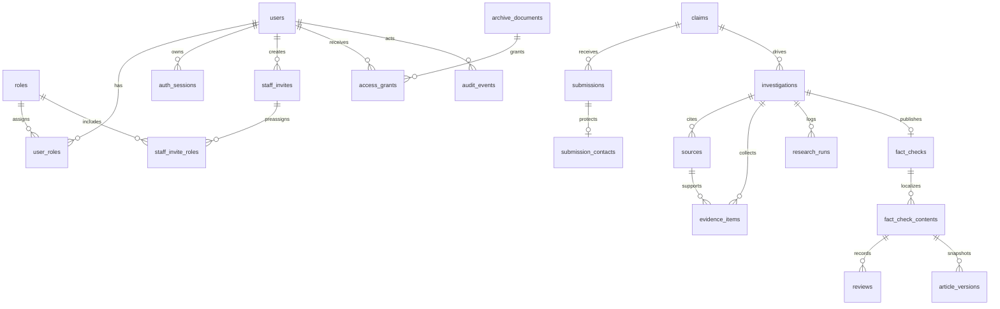

# Core data model (Phase 1)

This document describes the PostgreSQL schema introduced in Phase 1 Stage 1B. It establishes relationships and privacy boundaries only; editorial CRUD APIs arrive in later phases.

## Design principles

- UUID primary keys and UTC timestamps on mutable records.
- Explicit PostgreSQL enums and uniqueness constraints instead of ad hoc string columns.
- ORM models under `backend/app/models/` stay separate from Pydantic schemas under `backend/app/schemas/`.
- Workflow status (editorial lifecycle) is stored separately from public verdict labels.
- Tibetan (`bo`) and English (`en`) editorial copy lives in independent `fact_check_contents` rows.
- Submitter contact details live in `submission_contacts`, not in public claim text tables.
- Archive files default to `internal` visibility; publication does not widen archive access.
- `audit_events` and `research_runs` are append-oriented foundations for later phases.

## Entity graph



## Identity and staff access

| Table | Purpose |
| --- | --- |
| `users` | Staff accounts. Password hash and activation state are stored here; there is no public signup path. |
| `roles` | Normalized role catalog (`platform_administrator`, `researcher`, `editor`, `approver`). |
| `user_roles` | Many-to-many assignment with `(user_id, role_id)` uniqueness. |
| `staff_invites` | Single-use, time-limited invite metadata with hashed tokens. |
| `staff_invite_roles` | Roles to apply when an invite is accepted. |
| `auth_sessions` | Opaque session identifiers stored as hashes (cookie contract is implemented in Stage 1C). |

### Administrator role vs restricted archive access

`platform_administrator` governs account and configuration operations. It does **not** imply access to `restricted` archive documents or private investigation notes. Access to restricted material requires explicit `access_grants` (and later object-level policy checks). This keeps operational administration separate from sensitive editorial research.

## Intake and research

| Table | Purpose |
| --- | --- |
| `submissions` | Public or editorial intake records with workflow status starting at `inbox`. |
| `submission_contacts` | Optional submitter name/email/phone isolated from editorial claim text. |
| `claims` | Canonical claim identity; multiple submissions may link to one claim. |
| `investigations` | Private research workspace with owner, workflow status, and internal notes. |
| `sources` | Provenance for URLs, titles, publishers, and retrieval timestamps. |
| `evidence_items` | Excerpts and notes tied to investigations, optionally linked to sources. |
| `research_runs` | Provider/model/task metadata for future AI assistance (no execution in Phase 1). |

## Editorial and publication

| Table | Purpose |
| --- | --- |
| `fact_checks` | Editorial publication identity, workflow status, optional public slug. |
| `fact_check_contents` | Per-language title, summary, analysis, verdict, and translation status. |
| `reviews` | Reviewer decisions and comments per language content row. |
| `article_versions` | Immutable-ready JSON snapshots and publication metadata per language version. |

Workflow status enums follow the PRD lifecycle (`inbox` … `on_hold`). Public verdict enums (`true`, `false`, `misleading`, `unverified`, `unclear`) are stored on language content, not on workflow status fields.

## Archive and audit

| Table | Purpose |
| --- | --- |
| `archive_documents` | Metadata for archive items; new rows default to `internal` visibility. |
| `access_grants` | Explicit user grants to archive documents; `(archive_document_id, user_id)` is unique. |
| `audit_events` | Append-only record of security and editorial actions (payloads must stay redacted). |

## Migrations

Apply the schema with:

```sh
cd backend && uv run alembic upgrade head
```

The initial revision is `f4fcda4b6a93` (`initial core schema`). It seeds the four staff roles and must be reviewed before production deployment, consistent with the project’s additive migration policy.
