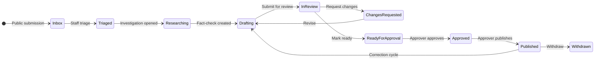
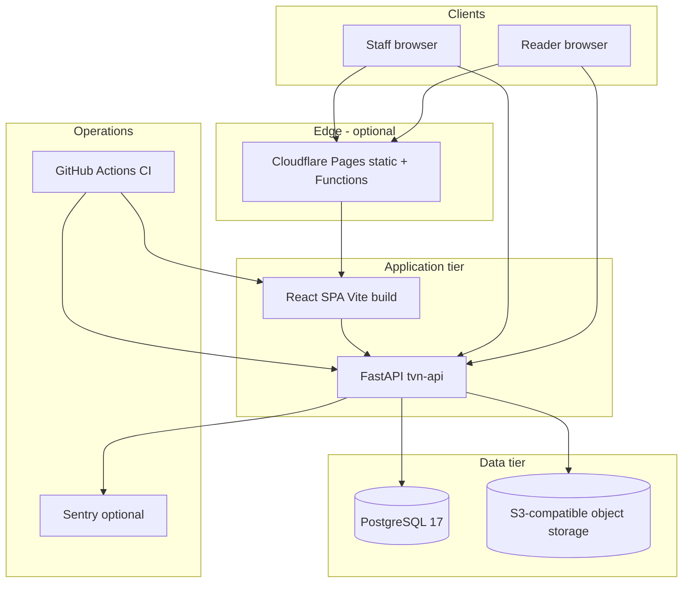
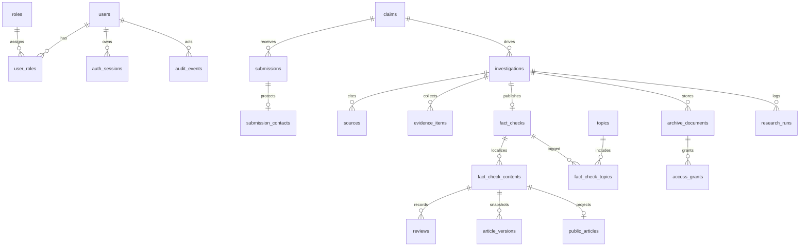
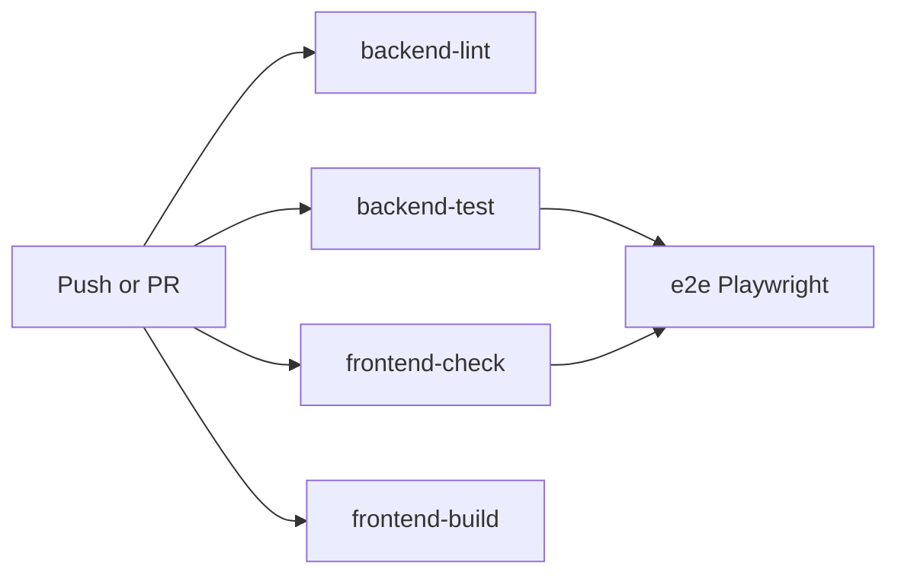

# Tibetan Verification Network — System Design Document

**Document type:** Technical design (derived from repository artifacts)  
**Product name in application:** Tibetan Verification Network (`PRODUCT_NAME` in `backend/app/core/constants.py`)  
**API version:** `0.1.0`  
**Primary requirements source:** [Tibetan_FactCheck_PRD_and_Design.md](Tibetan_FactCheck_PRD_and_Design.md) (working name “Tibetan FactCheck” in that file)  
**Last aligned with codebase:** October 2026  

Facts below come from code, configuration, models, routes, tests, and deployment-related files unless labeled **ASSUMPTION** or **OPEN QUESTION**.

---

## 1. Executive summary

The Tibetan Verification Network (TVN) is a bilingual (Tibetan `bo`, English `en`) fact-checking platform with a public read surface, anonymous claim submission, and an invite-only editorial workspace. The backend is a FastAPI service on PostgreSQL with Alembic migrations, object-level authorization, a workflow engine for submissions through publication, immutable article snapshots, and a denormalized public search index. The frontend is a React 19 SPA (Vite) with locale-prefixed public routes, a full editorial dashboard, CSRF-aware session auth, and optional Cloudflare Pages Functions for SEO metadata.

Staff accounts are created only via administrator invites; there is no public registration. Sensitive research (investigations, restricted archive, submitter contact data) is isolated from public APIs. Publication requires human review, independence guards (distinct author, ready-marking editor, approver), and checksum-verified snapshots.

**Not implemented in code today:** AI research execution (schema-only `research_runs`), automated email for invites, production deploy workflows, AWS/Azure infrastructure-as-code, and public archive document delivery.

---

## 2. Problem statement, goals, non-goals, and success metrics

### 2.1 Problem statement (from PRD, reflected in product scope)

Readers and communities need trustworthy, transparent, bilingual fact-checking about claims related to Tibet. Viral misinformation and disputed narratives require evidence-backed conclusions, clear provenance, correction history, and strict separation between public content and private editorial research.

### 2.2 Goals

| Goal | Evidence in repository |
| --- | --- |
| Publish searchable bilingual fact-checks | `public_articles` projection, `GET /api/v1/factchecks`, public frontend routes under `/en/` and `/bo/` |
| Accept public claim submissions | `POST /api/v1/submissions`, rate limits, optional Turnstile |
| Private editorial workflow | Investigations, drafts, reviews, approval queue, publication service |
| Object-level access control | `backend/app/core/policy.py`, query scoping, 404-on-deny |
| Traceability | `audit_events`, `article_versions`, reviews, workflow transitions |
| Private archive with visibility levels | S3-compatible storage, grants, presigned links |
| Low-cost hosting posture | `docs/hosting.md` target ~US$10–30/month (excluding variable AI) |

### 2.3 Non-goals (explicit in PRD; largely absent from code)

- Autonomous AI publication or verdicts without human approval
- Public reader accounts or comment forums
- Real-time monitoring of all social sources (P1 in PRD)
- Public release of full research archive (`PUBLIC_*` archive on public site deferred — [launch-decisions.md](launch-decisions.md))
- Guaranteed submitter anonymity beyond operational policy (**OPEN QUESTION** in PRD)

### 2.4 Success metrics

| Metric | Status |
| --- | --- |
| CI green on lint, migrations, pytest, Vitest, production build, Playwright | Encoded in `.github/workflows/ci.yml` and `docs/testing.md` |
| Permission and workflow regression coverage | `test_policy_*`, `test_workflow_*`, `tests/security/test_phase3_gate.py`, `test_ui_hidden_controls.py` |
| Production config refuses unsafe defaults | `Settings.check_production_constraints` in `backend/app/core/config.py` |
| Operational RPO/RTO numeric targets | **OPEN QUESTION** — runbook asks teams to document RPO/RTO; not fixed in code |
| Editorial throughput / SLA | **ASSUMPTION** — not instrumented in application metrics yet |

---

## 3. Users, roles, permissions, and access-control matrix

### 3.1 User classes

| Class | Authentication | Primary surfaces |
| --- | --- | --- |
| Reader | None | Locale-prefixed public SPA (`/en/...`, `/bo/...`) |
| Submitter | None | `POST /api/v1/submissions`, `/submit` page |
| Staff (researcher, editor, approver) | HttpOnly session + CSRF on mutations | `/editorial/*`, staff API |
| Platform administrator | Same session; role `platform_administrator` | `/api/v1/admin/*`, user admin UI |

There are no public reader accounts (`/register` is not found in the frontend).

### 3.2 Roles (`RoleCode` enum)

- `platform_administrator` — invites, disable users, role assignment
- `researcher` — triage, assigned investigations, drafting (with assignment)
- `editor` — full investigations, contact view (audited), archive reclassification, topics
- `approver` — approval queue, approve/publish/withdraw (read-only on unassigned investigations except queue visibility rules)

Users may hold multiple roles; workflow guards enforce separation of duties per language cycle ([editorial-policy.md](editorial-policy.md)).

### 3.3 Authorization model

- **Route-level:** `RequireStaff`, `RequirePlatformAdmin`, `require_roles`, `require_policy_action(Action.*)` in `backend/app/core/permissions.py` and `backend/app/api/deps/access.py`
- **Object-level:** `can(user, action, obj)` and SQL scoping (`scope_investigations`, `scope_factchecks`, `scope_archive_documents`, `scope_submissions`) in `backend/app/core/policy.py`
- **Failure mode:** Denied access to existing resources returns **404** (not 403) to prevent ID enumeration ([access-policy.md](access-policy.md))
- **Platform admin without editorial roles:** `is_platform_admin_only` denies all editorial/archive/submission policy actions

### 3.4 Access-control matrix (summary)

| Capability | Researcher | Editor | Approver | Platform admin (editorial roles absent) |
| --- | --- | --- | --- | --- |
| List/triage submissions | Yes (no contact) | Yes (+ contact, audited) | No | No |
| Investigations (view/edit) | Assigned | All | Assigned read-only | No |
| Archive internal | Assigned write context | All | Assigned view/download | No |
| Archive restricted | With `AccessGrant` | With grant; may grant if editor holds grant | With grant | No |
| Draft edit / submit review | Assigned write | Assigned write | No (view via assignment or queue) | No |
| Mark ready / review comment | No | Yes (on visible FC) | Request changes on visible FC | No |
| Approve / publish / withdraw | No | No | Yes (independence guards) | No |
| Topic manage | No | Yes | No | No |
| Staff directory | Yes | Yes | No | No |
| Audit log | No | Yes | Yes | No |
| Admin invites / users | No | No | No | Yes |

Full archive matrix: [access-policy.md](access-policy.md).

---

## 4. Functional requirements and core workflows

### 4.1 Functional requirements map

| ID | Requirement | Implementation |
| --- | --- | --- |
| FR-PUB-1 | Public fact-check library with search/filters | `list_public_factchecks`, public pages `SearchPage`, `Home` |
| FR-PUB-2 | Article detail and version history | `get_public_factcheck`, `ArticlePage`, `ArticleVersionPage` |
| FR-PUB-3 | Topics on public site | `GET /api/v1/topics`, `TopicsPage`, `TopicPage` |
| FR-PUB-4 | Public submission | `accept_public_submission`, `SubmitPage` |
| FR-ED-1 | Submission inbox and triage | `editorial_intake` routes, workflow on submissions |
| FR-ED-2 | Investigation workspace | Sources, evidence, assignments, status transitions |
| FR-ED-3 | Fact-check drafting (per language) | Editorial fact-check routes, Markdown preview/sanitize |
| FR-ED-4 | Review and approval | Reviews service, approval queue, readiness checks |
| FR-ED-5 | Publish, correct, withdraw | `publication.py`, immutable `ArticleVersion` |
| FR-ED-6 | Archive upload and grants | MinIO/S3 storage, presigned access links |
| FR-SEC-1 | Invite-only staff auth | Auth routes, invites, bootstrap CLI |
| FR-SEC-2 | Audit sensitive actions | `AuditEventType` constants, `record_audit_event` |

PRD functional IDs (FR-1, etc.) are traced in phase plans; this table uses repository-centric IDs.

### 4.2 Core workflow (high level)



Language content uses parallel `LanguageEditorialStatus` states managed by `backend/app/workflow/engine.py` with rollup to investigation/submission workflow status.

### 4.3 Publication integrity

- Snapshots: JSON in `article_versions` with checksum verification on public read (`verify_snapshot_checksum`)
- Public index: `public_articles` updated only inside publication transactions (publish, correction publish, withdraw)
- Withdrawn articles: remain addressable with notice; excluded from list, search, topics, sitemap ([launch-decisions.md](launch-decisions.md), frontend `WithdrawnNotice`)
- Independence: `backend/app/workflow/guards.py` — authors cannot approve; ready-marking editor cannot approve; only recorded approver may publish

### 4.4 Intake and abuse controls

- Body size cap: `SubmissionBodyLimitMiddleware`, `SUBMISSION_MAX_BODY_BYTES` (default 32768)
- Postgres-backed rate limits per IP and global (`submission_rate_limit_*` settings)
- Duplicate suggestion via trigram similarity (`SUBMISSION_DUPLICATE_SIMILARITY_THRESHOLD`)
- Optional Cloudflare Turnstile when `SUBMISSION_CAPTCHA_ENABLED=true`
- Contact fields stored in `submission_contacts`, never returned on public submission response

---

## 5. Non-functional requirements

| Category | Requirement | Implementation |
| --- | --- | --- |
| Security | Session hashing, CSRF on cookie mutations, CORS allow-list | `auth_sessions`, `permissions.py`, production CORS HTTPS-only |
| Security | No secrets in logs | `redaction.py`, structured JSON logging |
| Security | CSP and security headers on static host | `frontend/public/_headers` |
| Privacy | Submitter contact isolation | Separate table, editor-only view with audit |
| Availability | Liveness vs readiness | `/health` vs `/ready` (DB `SELECT 1`) |
| Performance | Public read caching | `Cache-Control: public, max-age=60, stale-while-revalidate=300` on public fact-check routes |
| i18n | Locale in URL for public pages | `/en/`, `/bo/`; editorial unprefixed |
| Accessibility | Automated axe in Vitest/Playwright | `docs/accessibility-testing.md`, `e2e/keyboard.spec.ts` |
| Maintainability | Strict API surface tests | `test_api_surface.py`, route policy inventory |
| Portability | Provider-agnostic hosting | `docs/hosting.md`, Docker images, env-driven storage |

**ASSUMPTION:** Target p95 API latency and concurrent user load are not defined in repository configuration.

---

## 6. High-level architecture



Local development: Docker Compose (`compose.yaml`) runs PostgreSQL, API, MinIO, and frontend dev/preview container on loopback ports 5432, 8000, 5173.

---

## 7. Technology stack and justification

| Layer | Choice | Rationale (from repo) |
| --- | --- | --- |
| API | Python 3.13, FastAPI, Uvicorn | PRD recommendation; async SQLAlchemy |
| ORM / migrations | SQLAlchemy 2.x, Alembic | Typed models, revision history in `backend/alembic/versions/` |
| Database | PostgreSQL 17 | Enums, GIN/trgm search, JSONB snapshots |
| Password hashing | argon2-cffi | Dependency in `pyproject.toml` |
| Object storage | boto3 S3 API | `app/storage/s3.py`; MinIO locally |
| Frontend | React 19, TypeScript, Vite 6 | `frontend/package.json` |
| Routing | react-router-dom v7 | Locale and editorial route trees |
| Data fetching | TanStack React Query | Editorial/public queries |
| HTML safety | DOMPurify, nh3 (backend Markdown) | XSS reduction |
| Testing | pytest, Vitest, Playwright, axe | `docs/testing.md` |
| Package mgmt | uv (backend), npm (frontend) | Lockfiles, CI pins uv 0.11.28 |

---

## 8. Module-by-module design

### 8.1 Backend packages

| Module | Responsibility |
| --- | --- |
| `app/main.py` | App factory, middleware stack, router mounting |
| `app/core/config.py` | Environment validation, production guardrails |
| `app/core/policy.py` | Authorization actions and query scoping |
| `app/core/permissions.py` | Session auth deps, CSRF, role requirements |
| `app/core/security.py` | Token hashing, generic error messages |
| `app/core/editorial_rules.py` | `MIN_PUBLIC_SOURCES`, default attribution string |
| `app/core/search_text.py` | Tibetan/English normalization for public search |
| `app/workflow/` | Transitions, guards, engine, HTTP error mapping |
| `app/services/intake.py` | Public submission and editorial triage |
| `app/services/drafts.py` | Draft CRUD, revisions, optimistic concurrency |
| `app/services/reviews.py` | Review steps, approval queue |
| `app/services/publication.py` | Snapshots, publish, withdraw, public index writes |
| `app/services/public_search.py` | Keyset list/search over `public_articles` |
| `app/services/archive.py` | Uploads, classification, grants, presigned URLs |
| `app/services/audit.py` | Append-only audit with payload sanitization |
| `app/services/captcha.py` | Turnstile verification adapter |
| `app/storage/` | `ObjectStorage` abstraction; memory factory for tests |
| `app/cli/bootstrap.py` | One-time platform administrator creation |
| `app/cli/rebuild_public_index.py` | Operational rebuild of `public_articles` |

### 8.2 Frontend structure

| Area | Responsibility |
| --- | --- |
| `src/routes.tsx` | Public locale routes + editorial nested routes with `RequireAuth` / `RequireRole` |
| `src/api/client.ts` | Credentials, CSRF header, retry on stale CSRF |
| `src/auth/` | Session bootstrap, login, activate |
| `src/editorial/` | Full dashboard pages (inbox, investigations, fact-checks, archive, admin) |
| `src/i18n/` | Custom i18n for `en` and `bo` (no i18n framework) |
| `functions/` | Cloudflare Pages Functions: meta tags, sitemap, robots, middleware |

### 8.3 Edge functions (Cloudflare)

`frontend/wrangler.toml` documents Pages output dir `dist`, example `API_BASE_URL` and `SITE_ORIGIN`. Functions fetch public API metadata for HTML injection ([hosting.md](hosting.md)).

---

## 9. API endpoint reference

Base path: `/api/v1`. OpenAPI at `/openapi.json` when `ENVIRONMENT != production`.

### 9.1 Endpoint table

| Method | Path | Auth | Purpose |
| --- | --- | --- | --- |
| GET | `/health` | None | Liveness |
| GET | `/ready` | None | DB readiness |
| GET | `/api/v1` | None | Service name and version |
| POST | `/api/v1/auth/login` | None | Session + CSRF token |
| POST | `/api/v1/auth/logout` | Session + CSRF | Revoke session |
| POST | `/api/v1/auth/activate` | None | Accept invite |
| GET | `/api/v1/auth/csrf` | Session | Rotate CSRF |
| GET | `/api/v1/me` | Session | Current user |
| GET | `/api/v1/admin/users` | Platform admin | List users |
| POST | `/api/v1/admin/invites` | Platform admin + CSRF | Create invite |
| POST | `/api/v1/admin/users/{id}/disable` | Platform admin + CSRF | Disable user |
| PUT | `/api/v1/admin/users/{id}/roles` | Platform admin + CSRF | Replace roles |
| POST | `/api/v1/submissions` | None | Public intake (202 + receipt) |
| GET | `/api/v1/factchecks` | None | Public search/list |
| GET | `/api/v1/factchecks/{slug}` | None | Live public snapshot + translation links |
| GET | `/api/v1/factchecks/{slug}/versions/{n}` | None | Historical public version |
| GET | `/api/v1/topics` | None | Active topics |
| GET | `/api/v1/topics/{slug}` | None | Topic detail + articles |
| GET | `/api/v1/editorial/status` | Staff | Protection probe |
| GET | `/api/v1/editorial/staff` | Policy | Assignable staff directory |
| GET | `/api/v1/editorial/approval-queue` | Approver | Queue |
| GET | `/api/v1/editorial/audit` | Editor/approver | Audit events |
| GET/PATCH | `/api/v1/editorial/submissions...` | Policy | Inbox |
| GET | `/api/v1/editorial/submissions/{id}/contact` | Editor | Contact (audited) |
| POST | `/api/v1/editorial/submissions/{id}/triage` | Policy | Triage |
| GET | `/api/v1/editorial/claims...` | Staff | Claims |
| GET/POST/PATCH | `/api/v1/editorial/topics...` | Policy | Topic admin |
| GET/POST/PATCH | `/api/v1/investigations...` | Policy | Investigations CRUD |
| POST/DELETE | `/api/v1/investigations/{id}/assignments...` | Policy | Assignments |
| * | `/api/v1/investigations/{id}/sources\|evidence...` | Policy | Research artifacts |
| POST | `/api/v1/investigations/{id}/documents` | Policy | Archive upload |
| POST | `/api/v1/investigations/{id}/factcheck` | Policy | Create fact-check |
| GET/POST/PATCH | `/api/v1/editorial/factchecks...` | Policy | Editorial FC lifecycle |
| * | `/api/v1/editorial/factchecks/{id}/languages/{lang}/*` | Policy | Draft, review, publish, versions |
| PUT | `/api/v1/editorial/factchecks/{id}/topics` | Policy | Topic assignment |
| GET | `/api/v1/archive/documents` | Policy | Archive list |
| GET/PATCH | `/api/v1/archive/documents/{id}...` | Policy | Metadata, classification, grants |
| POST | `/api/v1/archive/documents/{id}/access-link` | Policy | Presigned download |

Authoritative allow-list guard: `backend/tests/test_api_surface.py`.

### 9.2 Example requests

**Public submission**

```http
POST /api/v1/submissions HTTP/1.1
Content-Type: application/json

{
  "claim_text": "Example claim text for review.",
  "context": "Where this claim appeared.",
  "source_url": "https://example.org/article",
  "contact": {
    "name": "Optional Name",
    "email": "submitter@example.org",
    "phone": null
  },
  "privacy_consent": true
}
```

Response: `202 Accepted` with `{ "receipt_id": "<uuid>" }` (exact schema: `SubmissionReceiptResponse`).

**Staff login**

```http
POST /api/v1/auth/login HTTP/1.1
Content-Type: application/json

{ "email": "editor@example.org", "password": "..." }
```

Response sets `tvn_session` cookie and JSON `{ "csrf_token": "..." }`.

**Public fact-check list**

```http
GET /api/v1/factchecks?lang=en&q=verification&limit=20 HTTP/1.1
```

Response includes keyset cursor pagination and cache headers (`public, max-age=60`).

---

## 10. Database design

### 10.1 ER diagram (core entities)



Extended narrative: [data-model.md](data-model.md).

### 10.2 Migrations (Alembic revisions)

| Revision | Theme |
| --- | --- |
| `f4fcda4b6a93` | Initial core schema, role seed |
| `a1b2c3d4e5f6` | Phase 2 access policy schema, pg_trgm |
| `b7c8d9e0f1a2` | Phase 3.1 workflow schema |
| `c9d0e1f2a3b4` | Pending version kind |
| `d0e1f2a3b4c5` | Topics + `public_articles` |

### 10.3 Key tables (supplement)

| Table | Notes |
| --- | --- |
| `public_articles` | Denormalized search/list; not a source of truth for article body |
| `article_versions` | Immutable snapshots; checksum on read |
| `fact_check_content_revisions` | Material edits; feeds authorship guards |
| `rate_limit_buckets` | Postgres counters for submission abuse |
| `topics` | Bilingual names; deactivated, not deleted |

---

## 11. Security design, threat model, and controls

### 11.1 Threat model (STRIDE-oriented)

| Threat | Mitigation in repo |
| --- | --- |
| Spoofing (session theft) | HttpOnly cookie; hashed session tokens; logout/disable revokes rows |
| Tampering (CSRF) | Double-submit cookie pattern via `X-CSRF-Token` + Origin check |
| Repudiation | Append-only `audit_events` for sensitive operations |
| Information disclosure | 404-on-deny; public schemas forbid extra fields; snapshot key deny-list in security tests |
| Denial of service | Submission body limit, rate limits, query caps on public search |
| Elevation of privilege | Central `policy.can`; platform admin does not inherit archive access |

### 11.2 Preemptive controls

- Production refuses local DB password, HTTP CORS origins, default MinIO credentials, placeholder buckets
- Trusted Host middleware when `TRUSTED_HOSTS` set
- Markdown sanitized (`nh3`); frontend `SanitizedHtml` + DOMPurify
- Archive uploads: size/magic-byte validation (**OPEN QUESTION:** antivirus — [launch-decisions.md](launch-decisions.md))
- Sentry: `send_default_pii=False`, `max_request_body_size="never"`
- Security phase gates: `backend/tests/security/test_phase2_gate.py`, `test_phase3_gate.py`

### 11.3 Public snapshot leakage testing

`FORBIDDEN_SNAPSHOT_KEYS` in phase 3 security tests includes contact fields, storage keys, internal notes, raw review comments.

---

## 12. AI / LLM design

| Aspect | Status |
| --- | --- |
| Data model | `research_runs` stores `provider`, `model`, `task_type`, `status`, `output_text`, `source_references` (JSONB) |
| API / workers | **Not implemented** — no routes or job runner invoke LLMs |
| Product rule (PRD + phase plan) | AI must not approve or publish; human review required |
| Phase 5 scope | Provider-neutral adapter planned (`.cursor/plans/five-phase-tvn-plan_ec4890e6.plan.md`) |

**ASSUMPTION:** First provider and prompt versioning strategy will be chosen at Phase 5 implementation time.

---

## 13. Deployment architecture and CI/CD

### 13.1 AWS / Azure

**OPEN QUESTION:** This repository contains **no** Terraform, CloudFormation, ARM templates, or AWS/Azure-specific deployment manifests. Production guidance is provider-agnostic ([hosting.md](hosting.md)).

### 13.2 Documented candidate managed stack (planning artifact)

From `.cursor/plans/phase_4_detailed_plan_0363d147.plan.md` (**ASSUMPTION** until deploy workflows land in repo):

| Component | Candidate |
| --- | --- |
| Static frontend + edge | Cloudflare Pages + Pages Functions |
| API | Render or Fly.io container from `backend/Dockerfile` |
| PostgreSQL | Neon |
| Archive + backups | Cloudflare R2 (separate backup bucket for `pg_dump`) |

Domain pattern: `example.org` (site) and `api.example.org` (API) for first-party `SameSite=Lax` cookies.

### 13.3 CI/CD (implemented)



- Trigger: all pushes and PRs on GitHub Actions
- Backend tests: Postgres 17 service container, MinIO sidecar, `alembic upgrade head`, full pytest
- E2E: Compose stack, `seed_e2e.py`, Chromium + WebKit
- **OPEN QUESTION:** No automated deploy workflow to staging/production in `.github/workflows/`

### 13.4 Container images

- `backend/Dockerfile` — API production image
- `frontend/Dockerfile` — local dev/preview (not necessarily production static hosting)
- Compose binds services to `127.0.0.1` only

---

## 14. Scalability, caching, queues, backups, and disaster recovery

| Concern | Design |
| --- | --- |
| Scalability | Stateless API; horizontal scaling **ASSUMPTION** — session rows in Postgres, no sticky-session code |
| Caching | HTTP cache headers on public reads; CDN cache for static assets (`_headers` long cache on `/assets/*`) |
| Queues | **None** — no Celery/RQ/SQS; synchronous request handling |
| Rate limiting | Postgres-backed buckets, not Redis |
| Search scale | GIN indexes on `public_articles`; corpus seed script for query plans ([search.md](search.md)) |
| Backups | Runbook: managed PITR + optional encrypted `pg_dump` to object storage |
| Restore validation | `backend/scripts/restore_drill.py` — checksum all versions, rebuild index, compare counts |
| DR | RPO/RTO documented by operators — not automated in repo |

Object storage holds private archive bytes; publication does not widen archive visibility automatically ([data-model.md](data-model.md)).

---

## 15. Observability, logging, metrics, alerts, and runbooks

| Signal | Mechanism |
| --- | --- |
| Logs | JSON to stdout; request ID middleware; path-only access semantics (README) |
| Errors | Optional Sentry (`SENTRY_DSN`, `app/core/sentry.py`) |
| Health | `/health`, `/ready` for orchestrators |
| Metrics | **OPEN QUESTION** — no Prometheus/OpenTelemetry exporters in codebase |
| Alerts | **ASSUMPTION** — external uptime monitor on `/ready` mentioned in phase 4 plan, not configured in repo |

Operational procedures: [runbook.md](runbook.md) (deploy, rollback, migration failure, secret rotation, incident response, withdrawal/takedown).

---

## 16. Testing strategy

| Layer | Scope | Location |
| --- | --- | --- |
| Unit / service | Policy, workflow, intake, publication, search text | `backend/tests/` |
| Integration | HTTP API with real Postgres test DBs | pytest + httpx AsyncClient |
| Migration | Downgrade/upgrade cycle | `test_migrations.py` |
| Security gates | Phase 2/3 invariants | `backend/tests/security/` |
| Frontend unit | i18n, auth, editorial flows with fake API | Vitest, `src/test/editorialApi.ts` |
| a11y | axe on critical pages | Vitest + Playwright |
| E2E | Full editorial publish path, public flows, keyboard, security | `frontend/e2e/` |
| Build integrity | No leaked secrets/fonts/product name | `scripts/verify-dist.mjs` |

Local and CI entrypoints: `make test`, `make lint`, `docs/testing.md`.

---

## 17. Implementation roadmap, risks, assumptions, and open questions

### 17.1 Phased roadmap (from `.cursor/plans/five-phase-tvn-plan_ec4890e6.plan.md`)

| Phase | Focus | Repository status (feature-level) |
| --- | --- | --- |
| 1 | Foundation, schema, auth, CI | Implemented |
| 2 | Intake, investigations, archive, policy | Implemented |
| 3 | Workflow, publication snapshots, audit | Implemented (tests + services present) |
| 4 | Public site, search, editorial UI, e2e, hosting docs | Largely implemented; deploy automation open |
| 5 | AI assistance, launch hardening | **Not implemented** (schema only for `research_runs`) |

**Note:** YAML todo statuses inside plan files may lag the codebase; feature presence above is inferred from routes, frontend pages, and CI.

### 17.2 Risks

| Risk | Mitigation |
| --- | --- |
| Policy bypass via new routes | `test_api_surface.py`, `test_route_policy_inventory.py` |
| Snapshot tampering | Checksum verification; immutability tests |
| Submitter contact leak | Separate table, audit on view, security snapshot key tests |
| Tibetan search quality | Syllable token path + documented trgm spike ([search.md](search.md)) |
| Single-region dependency | **OPEN QUESTION** — no multi-region design in repo |

### 17.3 Assumptions

- Production will use HTTPS everywhere with explicit CORS origins
- Staff can operationalize three-role independence per language cycle
- S3-compatible storage remains compatible with boto3 presigning used in archive service
- Cloudflare Turnstile is acceptable when captcha is enabled

### 17.4 Open questions (see also [launch-decisions.md](launch-decisions.md))

- Final hosting vendor and deploy pipeline (AWS/Azure vs Cloudflare/Neon/R2/Render)
- Contact-data retention period
- Antivirus scanning for archive uploads
- Public API payload trimming for withdrawn articles (defense in depth)
- Approver-unavailable fallback
- Attribution style (named staff vs team byline)
- AI provider, cost caps, and data handling for Phase 5
- Numeric SLOs, metrics, and on-call alerting

---

## Appendix A — Configuration reference (non-secret)

Key environment variables are documented in `.env.example` and validated in `Settings`. Production-specific rules are summarized in [hosting.md](hosting.md) and the README configuration section.

## Appendix B — Related documentation

| Document | Topic |
| --- | --- |
| [authentication.md](authentication.md) | Sessions, CSRF, invites |
| [access-policy.md](access-policy.md) | Role matrix, archive flow |
| [editorial-policy.md](editorial-policy.md) | Publication rules |
| [data-model.md](data-model.md) | Tables and privacy boundaries |
| [local-development.md](local-development.md) | Compose, migrations, e2e |
| [Tibetan_FactCheck_PRD_and_Design.md](Tibetan_FactCheck_PRD_and_Design.md) | Product requirements |
