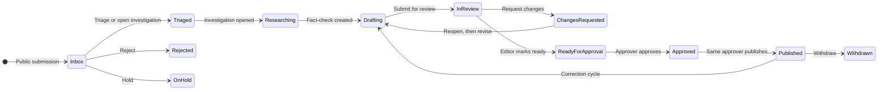

# Claim workflow testing guide

Use this guide to walk **one public claim** through the editorial workspace with three separate people: a **researcher**, an **editor**, and an **approver**. It describes the workflow the application enforces today, what each role is responsible for, and where the handoffs are easy to get wrong.

This is a manual test of the product, not a substitute for `make test`. The rules it checks are implemented in `backend/app/core/policy.py`, `backend/app/workflow/`, and the editorial screens under `/editorial`. The design summary is in [design-document.md](design-document.md) (sections 3 and 4). Publication rules are in [editorial-policy.md](editorial-policy.md). Visibility rules are in [access-policy.md](access-policy.md).

## What you are proving

One claim moves through these stages, and no single person can finish it alone:

1. A reader submits a claim with no account.
2. A researcher or editor triages it and opens an investigation.
3. The researcher gathers sources, verifies evidence, and writes the draft.
4. An editor who did **not** write the draft marks that exact revision ready.
5. An approver who did **not** write the draft and did **not** mark it ready approves it, then publishes it.
6. Readers can open the article. A later correction or withdrawal goes through the same independence rules again.

English (`en`) and Tibetan (`bo`) are separate language tracks on the same fact-check. This guide publishes **English first**, then notes what that does to the Tibetan track.

## People and browsers

You need **four accounts**, and **three browser profiles**. The session is one HttpOnly cookie (`tvn_session`) per browser profile. Three tabs in the same window are the same person.

| Account | Role to assign | Used for |
| --- | --- | --- |
| Platform administrator | `platform_administrator` only | Invites the other three. Does not touch the claim. |
| Researcher | `researcher` only | Inbox, investigation, draft, submit for review. |
| Editor | `editor` only | Contact check, assignment, review, mark ready. |
| Approver | `approver` only | Approval queue, approve, publish, and later withdraw. |

Give each editorial person **one role**. A user can hold several roles, but this test is about the separation the product actually enforces: three different people per language cycle. The platform administrator with no editorial role is refused every editorial action. That refusal is expected.

Sign-in is at `/login`. There is no `/register` page. Invites are created by the administrator at `/editorial/admin/users`. The invite link is shown once (`/activate?token=...`). The API does not email it. Passwords must be at least 12 characters.

Local stack, if you are not already running it: [local-development.md](local-development.md). Open the site and the API on the **same host** (`127.0.0.1` or `localhost`, not a mix). Cookies and the CORS list treat those as different sites.

Suggested labels so the audit log is readable: `Avery Researcher`, `Eden Editor`, `Ari Approver`.

## What each role is responsible for

Navigation is the first check. After each person signs in, `/editorial` should show only their items.

| Screen | Researcher | Editor | Approver |
| --- | --- | --- | --- |
| Overview | Inbox, assigned investigations, assigned drafts | Those, plus fact-checks in review | Approval queue only |
| Inbox | Yes, without submitter contact | Yes, and contact (each view is audited) | Hidden |
| Investigations | Assigned only, including ones they own | All | Assigned only, and read-only |
| Fact-checks | Assigned; can edit a draft | All; can review | Assigned, or any language that is ready or approved; cannot edit the draft |
| Approvals | Hidden | Hidden | Yes |
| Archive | Assigned investigation | All internal documents; restricted needs a grant | Assigned, view and download |
| Topics | Hidden | Yes | Hidden |
| Staff accounts | Hidden | Hidden | Hidden |
| Audit log on a record | Hidden | Yes | Yes |

Denied access to a record that exists returns **404**, not 403, so people cannot probe ids. A missing menu item, an empty list, or a not-found page during the negative checks below is a pass.

### Researcher

- Triage the inbox: reject, hold, create or link a canonical claim, mark a duplicate, or open an investigation.
- Cannot assign the submission to someone else, and cannot see contact details.
- Whoever clicks **Open investigation** becomes that investigation’s owner. A researcher who is not the owner cannot see it until an editor assigns them.
- On an investigation they own or are assigned to: add sources, evidence, notes, and archive files; verify evidence; create the fact-check; write and save the draft; cite sources; submit for review.
- Cannot mark ready, approve, publish, withdraw, manage topics, or open the audit log.
- After **Submit for review**, the investigation workspace locks. Further writing happens on the language page, and only after the draft is reopened.

### Editor

- Everything the researcher can do on intake, plus submitter contact and assignment.
- Sees every investigation, not only assigned ones.
- Adds people to the investigation (**Assign**) while it is still **Researching** or **Drafting**.
- Reviews a language that is **In review**: comment, request changes, or **Mark ready for approval**.
- Must not be an author of that language cycle. Saving the draft counts as authorship. Use **Add comment** instead of **Save draft**.
- Cannot approve, publish, or withdraw.
- Manages topics, reclassifies archive documents, and reads the audit log.
- Contact views and other sensitive actions are written to the audit log. Open contact only when the test step says so, and confirm an audit row appears.

### Approver

- Does not see the inbox or contact details.
- Sees an investigation only after an editor assigns them. Until then they cannot read sources, evidence, or notes.
- Sees the approval queue when a language is **Ready for approval**, even without an assignment. The queue hides items they authored or marked ready.
- On a visible fact-check: request changes, approve one exact revision, publish that revision, start a correction, or withdraw.
- Cannot edit the draft, mark ready, or assign people.
- Only the approver who recorded the approval can publish that revision. A second approver cannot publish it for them.

## The path of one claim

Two status fields move together:

- **Submission status** stops at triaged, rejected, or on hold. Opening an investigation also marks the submission triaged.
- **Language status** is the real editorial state (`draft`, `in_review`, `changes_requested`, `ready_for_approval`, `approved`, `published`, `withdrawn`). The fact-check and the investigation badge are a rollup of the language rows (`backend/app/workflow/rollup.py`).

The investigation page turns read-only when that rollup is **In review**, **Changes requested**, **Approved**, or **Published**. Add sources and assign the approver before anyone submits a language for review.

## Before you start

1. Administrator signs in and invites the three people, one role each.
2. Each person opens their own browser profile, activates, and signs in.
3. Each person checks the menu against the table above.
4. Agree on one claim you have not used before, for example: “A new highway from Lhasa to the border opened to traffic last month.” Keep the wording unique so duplicate suggestions stay quiet on the first pass.
5. Pick a public slug you will type later, such as `lhasa-highway-opened`. It cannot change after the first language is published.

Write the claim id, investigation id, and fact-check id in the scorecard at the end as you go. They appear in the address bar (`/editorial/inbox/...`, `/editorial/investigations/...`, `/editorial/factchecks/...`).

## Walkthrough

Stay in this order. If a button is missing, check the role and the status badge before treating it as a bug.

### 1. Reader submits the claim

In a browser that is **not** signed in, open `/en/submit` (or `/bo/submit`).

- Enter the claim, a short context sentence, and a source URL.
- You may enter contact details. The success response must not repeat them.
- You should land on a confirmation, with no staff menu and no way to see the submission again.

There is no reader account. Submissions are capped (default 32 KB) and rate-limited per IP and globally. Repeating the form quickly can be rejected for that reason.

### 2. Researcher triages and opens the investigation

Sign in as the researcher. Overview should list the new claim under Inbox.

Open it.

- Confirm the original wording is visible.
- Confirm there is **no** contact block.
- Confirm **Assign** is not offered. Reject, hold, create claim, link claim, and open investigation are.
- If duplicate suggestions appear, open one and come back. Do not mark this first claim as a duplicate.
- Click **Open investigation** and confirm.

Expected:

- Submission badge becomes **Triaged**.
- You are the owner, so the investigation opens and its badge is **Researching**.
- The approver’s overview does not change. The editor can open the same investigation from Investigations without being assigned.

### 3. Editor checks contact, then assigns the approver

Sign in as the editor. Open the same submission from Inbox.

- Open the contact details once. Sign out is not required; just record that you could see them.
- Open the investigation. **Assign** the approver (contributor is enough). You should see “Person assigned.”
- Do not edit sources or the draft in this step. A saved draft would make you an author, and you would then be blocked from marking it ready.

Expected for the approver after a refresh: the investigation appears in their list, and the workspace is read-only (no add-source or save-draft controls). They still have nothing in the approval queue.

### 4. Researcher builds the file and the English draft

Back as the researcher, on the investigation, while the badge is still **Researching** or **Drafting**:

1. Add one source (title, publisher, and an `https://` URL).
2. Add an evidence excerpt tied to that source, then **verify** it. Unverified evidence blocks approval later.
3. Add an internal note that a reader must never see, for example `Internal: tip received via the public form.`
4. Create the fact-check with **English and Tibetan** both checked.
5. On the fact-check, set the public slug.
6. Open the **English** language page and fill every required field:
   - title, the claim, context, verdict, why this verdict
   - analysis (Markdown) and limitations (Markdown), both non-empty
   - translation status for the other language: use **unavailable** or **original**, not “translation published”
7. Cite the source you created and save sources.
8. Save the draft. The page should name a revision number.
9. Read the readiness panel. It should have no remaining issues. If it lists any, fix them before the next step. Mark-ready and approve run the same checks.
10. **Submit for review.**

Expected:

- English badge becomes **In review**. The page says an editor marks it ready.
- The draft fields lock.
- The investigation badge becomes **In review** and the page says it is frozen. Sources, evidence, notes, uploads, and **Assign** are gone.
- Tibetan can still be a draft. Leave it for later.
- The editor’s overview gains this fact-check under review.
- The approver’s queue stays empty. Ready-for-approval is what fills it, not in-review.

### 5. Editor marks it ready

As the editor, open the English language page from the review list. Do not click **Save draft**.

- Add a short review comment so the thread has a record.
- Click **Mark ready for approval** and confirm. The consequence text should name the revision number.

Expected:

- English becomes **Ready for approval**.
- The approver’s overview and `/editorial/approvals` list this language, with the same revision number.
- If you instead saved the draft before marking ready, the mark-ready action fails because you are now an author. Revert that test user to a clean editor who has not saved, or start a new claim. Do not “fix” it by giving the editor the approver role.

Optional side check, still as the editor: open the audit panel and confirm the triage and the contact view are listed. The researcher’s session must not show that panel.

### 6. Approver approves and publishes

As the approver, open the item from **Approvals**. It lands on the English language page.

- Confirm you can read the draft and the cited source.
- Confirm you cannot edit the fields.
- Open the investigation from the fact-check link. You should see the source, the verified evidence, and the internal note, and you should not see edit controls.
- Return to the language page. **Approve** the revision shown. The button names that revision on purpose. If someone saves again, this approval no longer matches and you must not publish a newer unsaved revision.
- After the badge says **Approved**, **Review and publish**, then confirm.

Expected:

- English becomes **Published**.
- A signed-out browser can open `/en/fact-checks/lhasa-highway-opened` (your slug) and see the title, claim, verdict, analysis, and source.
- The article appears in `/en/fact-checks` search.
- The internal note is not on the public page.
- `/bo/fact-checks/<slug>` does not show a Tibetan article yet.
- The investigation stays frozen, because any published language keeps the rollup at **Published**.

Only this approver can publish. A second approver account, if you have one, can open the approved language and must be refused at publish.

### 7. What the other two see after publication

- Researcher: the fact-check is published; the English draft is locked; they still cannot approve or withdraw.
- Editor: they can read the audit trail; they cannot withdraw.
- Approver: the queue no longer offers this language for approval. **Withdraw** and **Start a correction** are available on the published language page.

## Negative checks

Run these on the same claim. Each one should fail closed.

| Try this | As | Expected |
| --- | --- | --- |
| Open `/editorial/inbox` | Approver | Inbox is not available |
| Open the submission and look for contact | Researcher | No contact fields |
| Assign a person on the submission | Researcher | No Assign action |
| Open the investigation by pasting its URL before the editor assigns you | Approver, before step 3 | Not found, or the investigation is absent from the list |
| Save the English draft, then mark ready | Editor | Refused: authors cannot mark their own draft ready |
| Approve the revision you just marked ready | Editor who also has approver, if you test this separately | Refused: the editor who marked it ready cannot approve it |
| Approve your own draft | Researcher who also has approver | Refused, and the queue hides their own authorship |
| Publish after a different approver approved | A second approver | Refused: only the recorded approver can publish |
| Edit sources after submit-for-review | Researcher | Investigation page is frozen |
| Put the investigation on hold, then approve | Editor, then approver | Approval blocked while the investigation is on hold or rejected |

The frontend hides many of these buttons. Hiding is a hint. The API still enforces the rule. A control you force through the network should get **404** for a record the role cannot see, or **409** when the transition or independence guard refuses it.

## Branches worth one extra pass

### Request changes

On a second claim, or before step 6 on a copy, the editor clicks **Request changes** with a reason instead of mark ready.

- English becomes **Changes requested**.
- The researcher does not edit in place. They **reopen as draft**, change the text, save, and submit for review again.
- The editor marks the new revision ready. The old revision is not what the approver approves.
- While the status is **Changes requested**, the investigation is frozen. Reopen the language first; the rollup returns to drafting if nothing is published yet, and source edits work again.

### Correction

On the published English page, as the approver, **Start a correction** (correction, update, or clarification) and give an internal reason.

- The live article stays up.
- English returns to draft for a new cycle. Authorship resets at `cycle_started_at`, so a new writer, editor, and approver are required for the new cycle.
- The researcher edits, the editor marks ready, the same rules apply, and publish now requires a **public correction note**.
- The previous public version remains on `/en/fact-checks/<slug>/versions/1`.
- The investigation page stays frozen for the whole correction, because a live version still exists. New sources cannot be added there. Cite sources that were added before the first publish, or treat “need a new source after publication” as a gap (see improvements).

### Withdrawal

As the approver, withdraw the published English article. Enter a public notice and an internal reason.

- The public URL still opens and shows the withdrawal notice, not the article body.
- The article drops out of search, topics, and the sitemap.
- Older versions remain in the version history.
- The editor and the researcher cannot withdraw it.

### Duplicate submission

Submit almost the same claim again from the public form. As the researcher, the new inbox item should suggest the first submission (trigram similarity). Marking it as a duplicate records the link; it does not by itself open a second investigation.

## Readiness checklist

Mark-ready, approve, and publish all refuse until every item below is true. The language page lists the failures.

- Title, claim, context, verdict, and verdict explanation are non-empty.
- Analysis and limitations are non-empty Markdown and still non-empty after sanitizing.
- At least one source from this investigation is cited.
- Evidence linked to every cited source is verified.
- The fact-check has a public slug.
- Translation status matches reality. “Pending” is refused once the other language is published. “Translation published” is refused before this language is published.
- The investigation is not on hold or rejected.

## How the workflow behaves, and what to improve

These are properties of the current product, found while tracing the roles above. They are the useful outcome of the test, not a change list to implement in the same pass.

**Assign the approver before submit-for-review.** **Assign** disappears once the investigation is in review, and it never comes back after publication. The approver can still approve from the queue without an assignment, which means they can approve without ever seeing evidence or the internal note. Make “approver assigned, and has opened the investigation” a required editorial step while the badge still says Researching or Drafting.

**Opening the investigation picks the owner.** That person is the only non-editor who can see the file. **Assign** on the submission does not grant investigation access; assignment on the investigation does. If an editor opens the investigation “to get it started,” the researcher’s list stays empty until the editor adds them. Prefer: the researcher opens it, and the editor’s first action is assigning the approver.

**The editor must not tidy the draft.** Authorship is anyone who saved a material revision in this cycle, not the person who clicked submit. A helpful save blocks mark-ready. Keep review comments in the review thread. A useful product change is a warning on **Save draft** when the current user is the only editor available to mark ready.

**One published language freezes the whole investigation.** The rollup treats any live version as published, including during a correction and after withdrawal. The second language, and any correction, can still be edited on the language page, but new sources, evidence, notes, and assignments cannot. Finish shared research before the first publish. A better rollup would freeze only the published language’s snapshot, and leave the investigation writable until every language is done or the investigation is explicitly closed.

**The approver’s overview is only the queue.** They are not shown assigned investigations, so nothing prompts them to read the file before it is marked ready. Showing assigned investigations on their overview would match the access they already have.

**Changes requested is two steps.** The writer reopens to draft, then edits. The frozen investigation in between feels like a stuck record if you do not know to reopen. The language page already says to reopen; the investigation banner could say the same thing.

**Publish is personal, not just role-based.** If the approving person is unavailable, another approver cannot publish that revision. The team needs a standby approver who can be asked to approve again, or a later product change that lets a second approver take over an approval explicitly.

**There is no notification when the claim moves.** Each person discovers work by refreshing `/editorial`. Until that exists, end each step by telling the next person the revision number, not only the claim title. Approve and publish are tied to that number.

**Contact stays with the editor.** The researcher triages from the claim text alone. If a tip only makes sense with the sender’s identity, the editor should read contact, write a non-sensitive internal note on the investigation, and leave the contact details out of the draft, the sources, and the public article.

**Smallest staff that can publish is three people.** Two accounts cannot complete a cycle, even if one of them holds every role: the author, the ready-marking editor, and the approver must be different users. Plan the test, and the newsroom, around that.

## Scorecard

Copy this for each claim you run.

| Step | Person | Result | Revision or id |
| --- | --- | --- | --- |
| Public submit succeeded, contact not echoed | Reader | | |
| Researcher sees inbox item, no contact, no Assign | Researcher | | |
| Investigation opened; researcher is owner | Researcher | | |
| Editor saw contact; audit row exists | Editor | | |
| Approver assigned while badge was Researching or Drafting | Editor | | |
| Source added, evidence verified, slug set, readiness clear | Researcher | | |
| Submitted for review; investigation frozen | Researcher | | |
| Editor marked ready without saving the draft | Editor | | |
| Approver queue shows that revision | Approver | | |
| Approved, then published, by the same approver | Approver | | |
| Public English URL shows the article and hides the internal note | Reader | | |
| Researcher and editor cannot withdraw | Researcher, editor | | |

Claim text:

Slug:

Submission id:

Investigation id:

Fact-check id:

Notes for a workflow change:
